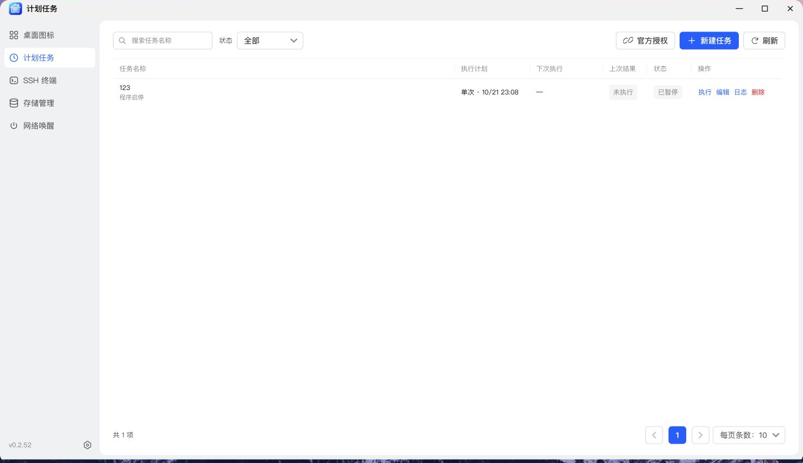
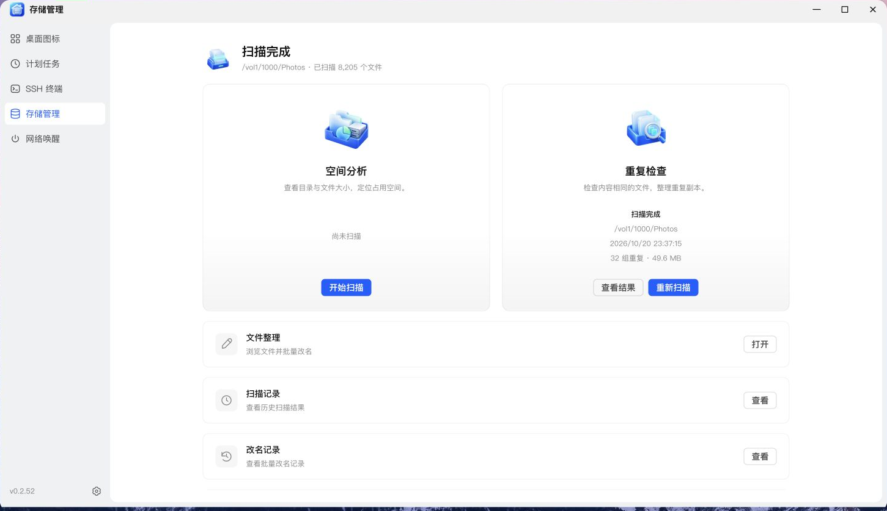

# NAS 管家

桌面图标 · 计划任务 · SSH 终端 · 存储管理 · 网络唤醒

---

## 目前个人开发者的应用实在差强人意。

最初只是部署了一个 Docker 容器，想找个终端调试，并且实现生成桌面图标，翻了翻论坛，看了一圈应用截图和介绍，实在不符合我的审美。

**一个是界面。** 有些设计停在了“能用就行”，各有各的风格，乱七八糟，甚至还有组件没加样式就裸奔。特别是配色，纯纯光污染标题框是浅色的，内容却是固定的深色，违和感拉满了，还有哪些小字的提示啊密密麻麻，像是看小说一样，喧宾夺主。

**另一个是分散。** 加个桌面图标要打开一个应用，连接 SSH 又是另一个。窗口越来越多，用完这个开哪个，非常不适（考虑到总会有人就喜欢单独应用，所以也支持在桌面图标菜单把单个菜单功能添加到飞牛桌面）。

既然一个都看不上，身为一个程序猿，还是个追求完美的处女座，那就自己做一个用。于是有了 NAS 管家，分享给大家内测。

常用工具集中管理，直接打开独立窗口。喜欢统一入口，或习惯按功能分别打开，都可以按自己的方式使用。

还有就是飞牛的开发者文档很久不更新，标题栏只能改文字，想加个按钮还得放到详情界面里。

## 五个常用功能

| 菜单         | 它能帮你做什么                                     | 一个常见场景                         |
| :----------- | :------------------------------------------------- | :----------------------------------- |
| **桌面图标** | 给 Docker、自定义链接及 NAS 管家菜单创建桌面入口   | 把常用服务放到桌面，少记几个端口     |
| **计划任务** | 定时启停程序、控制容器、运行脚本，联动网络设备     | 工作日前唤醒电脑，夜间执行维护脚本   |
| **SSH 终端** | 多标签连接、文件管理、常用命令、监控与 AI / Skills | 一边查看资源，一边通过终端处理问题   |
| **存储管理** | 分析空间、查重、批量改名、记录与 AI 附件清理       | 找出大文件，整理重复照片和杂乱文件名 |
| **网络唤醒** | 扫描局域网、批量添加设备、唤醒与 SSH 电源控制      | 用一直在线的 NAS 唤醒局域网电脑      |

## 功能统一，双端也要统一

除了界面风格，我也比较在意 PC 和手机上的使用体验。手机屏幕小、操作习惯不同，因此针对小屏幕单独调整了布局和操作步骤。

### PC：以直观的形式展示

桌面端使用清晰的表格、卡片和侧边导航。SSH 连接后进入完整工作区，支持多标签，左右面板可以调整宽度；存储管理也有独立工作区，处理文件时不用在一堆按钮之间来回找入口。

### 手机：单独样式适配

移动端对列表、筛选和操作入口做了单独调整：卡片展示、底部导航、底部弹出面板、下拉刷新，以及更适合触摸的操作方式。

尤其是 SSH 终端的手机适配，折磨了好久。现在可以通过图标切换终端侧边功能，展开文件管理或侧边菜单时，仍能继续使用当前终端。

## SSH 的 AI 助手

不常用的终端命令容易忘，排查问题也经常需要查资料，所以在 SSH 工作区加入了 AI 助手，方便结合当前主机的命令结果分析问题。

支持配置多个供应商，协议包括 **OpenAI、Claude、Ollama、Gemini、GLM、MiniMax、DeepSeek、MiMo**。

填写接口信息后，可以测试连接、读取模型列表，再通过对话让 AI 协助检查当前 SSH 主机。回答支持 Markdown；命令既可以逐条审核，也可以在主动选择静默模式后自动执行。

供应商提供 OpenAI 兼容接口时，也可以选择 OpenAI 协议接入。AI 的判断和命令可能有误，首次使用建议保持逐条审核。

AI 还支持文件附件、图片预览和 Skills。将 ZIP 技能包或 HTTPS 下载链接发给 AI，即可由 AI 检查、安装并启用；安装和运行工具都遵循当前审核模式。技能管理用于查看、启停和删除。聊天附件在存储管理中统一查看和清理。

常用命令库提供参数与中文说明，支持分类、搜索、自定义及输入提示；无需为了查一句命令就发起 AI 请求。

## 从哪里开始？

1. 准备 NAS 管家的 `.fpk` 安装包，在飞牛应用中心选择 **手动安装**。
2. 安装并启动后，使用具有管理权限的飞牛账号，从桌面打开 **NAS 管家**。
3. 先从自己最常用的菜单开始；需要系统能力时，再完成相应授权或连接配置。

### 版本与使用条件

- 当前发布包为 **v0.2.52 / x86_64**，安装前请确认设备架构一致。ARM 版本尚未经过真机测试，暂未提供。
- 部分计划任务需要单独完成飞牛官方授权，具体步骤见[计划任务教程](docs/scheduled-tasks.md)。
- 当前不支持通用系统缓存清理、触发飞牛备份和创建快照。
- 网络唤醒中的 SSH 电源控制尚未完成真机验证，使用前请先在目标设备上测试。

## 五篇上手攻略

| 想做的事                    | 阅读教程                                             |
| :-------------------------- | :--------------------------------------------------- |
| 把常用服务放上桌面          | [NAS 管家——桌面图标教程](docs/desktop-icons.md)      |
| 把重复操作交给时间          | [NAS 管家——计划任务教程](docs/scheduled-tasks.md)    |
| 连接主机、管理文件、使用 AI | [NAS 管家——SSH 终端教程](docs/ssh-terminal.md)       |
| 找出空间去向、整理文件      | [NAS 管家——存储管理教程](docs/storage-management.md) |
| 批量唤醒、管理局域网设备    | [NAS 管家——网络唤醒教程](docs/wake-on-lan.md)        |

## 界面预览

以下图片已于 2026-10-23 按最新部署重新拍摄，均来自 v0.2.52 的 NAS 真机浏览器界面，按文档分别保存。表单截图使用未提交的草稿；截图中的设备、目录和容器名称仅为当前环境示例。

### 桌面图标与计划任务

### SSH 终端与文件管理

### 存储管理与网络唤醒

---

**开发者 / 发布者：[kaf](https://club.fnnas.com/home.php?mod=space&uid=91804)**

后续会根据实际使用需求继续完善。欢迎参加内测，反馈使用建议和遇到的问题；描述问题时，请附上应用版本、设备架构、操作步骤和相关截图，方便排查。
