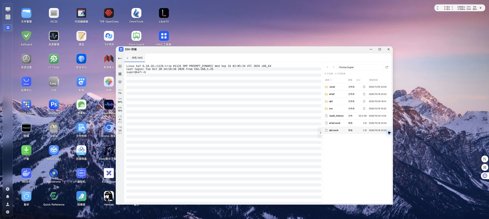
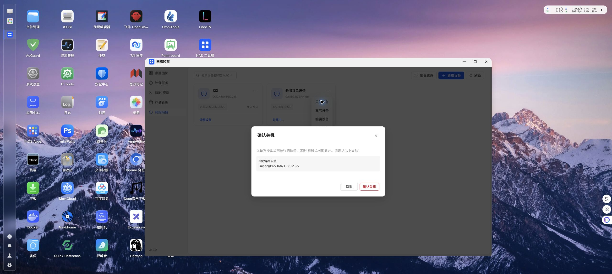

# NAS 真机五菜单验收

日期：2026-10-20。设备：192.168.1.35，应用版本 v0.2.9。

使用已安装应用的 Unix Socket API 与飞牛桌面内嵌网页进行验证。以下结果来自真实 NAS 服务，未替换后端执行器。通过临时数据验证写入操作，保留原有配置和业务文件。

| 顺序 | 菜单 | 已验证功能 | 结果 |
| --- | --- | --- | --- |
| 1 | 桌面图标 | 读取 11 个 Docker 容器；新增、编辑、PNG 图标读取；实际安装临时桌面入口并卸载 | 通过 |
| 2 | 计划任务 | 脚本手动执行、实际单次定时触发、成功日志；任务新增编辑删除；设备任务实际发送 UDP 并记录逐台结果；官方授权状态及日志模块查询 | 通过 |
| 3 | SSH 终端 | 保存临时远程连接；真实 SSH 握手、认证与终端输入输出；已保存本机连接的界面连接、全屏终端和标签关闭；SFTP 新建目录、进入子目录、连续读取、上传下载字节一致、重命名、目录大小计算和删除 | 通过 |
| 4 | 存储管理 | 目录选择；递归空间分析、内容重复检查；临时重复副本移动与删除、保留副本内容验证；改名预览、执行、撤销；扫描与改名记录删除；现有结果列表、排序、重复组详情、记录页面 | 通过 |
| 5 | 网络唤醒 | 临时设备新增编辑删除；真实 UDP 单台与批量收发；校验 6 字节 FF 加 16 次 MAC、总计 102 字节；发送时间记录；未绑定设备无电源菜单，已绑定设备有关机与重启菜单，确认目标正确并取消 | 通过 |

## 边界

- 按用户要求，未执行重启 NAS。
- 未向真实设备提交关机、重启指令，电源操作验证至确认弹窗与取消。
- 未对原有应用、Docker 容器执行启停，未清空用户回收站、历史日志或系统缓存。应用及容器控制的实际启停不在本次通过范围内。
- 唤醒验证证明 NAS 能提交正确数据包，不证明现有物理设备的 BIOS、网卡及交换机配置能使其开机。
- 本轮为桌面浏览器加 NAS 后端验证，未使用实体手机进行移动端验收。
- 浏览器日志中有 14:11 的历史 SDK 初始化异常记录，不能据本轮主要流程通过宣称所有历史控制台问题已经消失。

## 清理

临时桌面入口、任务及执行记录、SSH 连接、终端会话、唤醒设备、扫描记录、改名和撤销记录、测试目录均已清理。结束时原有图标、任务、SSH 配置、唤醒设备各 1 条，扫描记录 9 条，改名记录 0 条。两秒唤醒限流已验证生效；测试脚本在满足间隔后批量发送通过。

