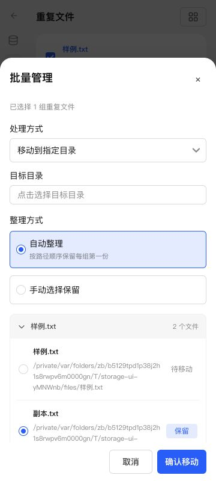
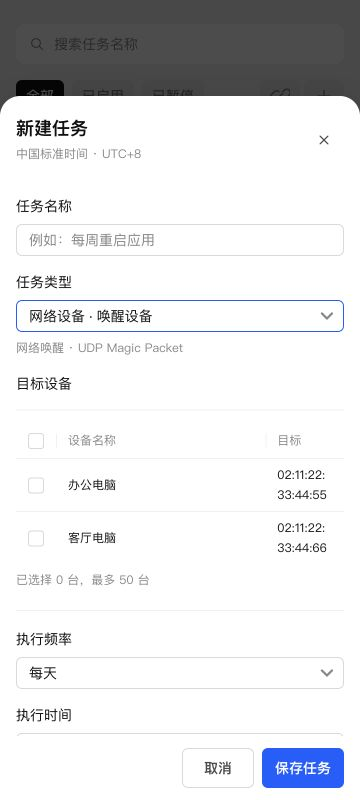
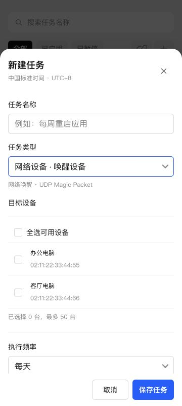
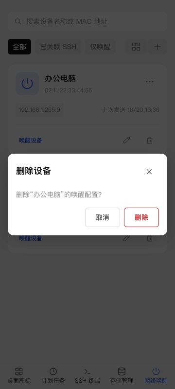

# UI 样式与交互一致性审查

日期：2026-10-20。对象：NAS 管家当前源代码与生产构建。

检查尺寸：1280×800、621×700、360×800；另检查深色主题。使用本地预览数据，不修改 NAS 用户数据，不执行设备电源操作。模拟窄屏不替代实体手机键盘和手势测试。本轮仅审查，未修改应用代码。

依据：项目已有 `docs/integrations/ui-alignment.md`、共用组件和用户确认过的布局。官方公开资料不是完整的移动端视觉验收规范，因此下列结论是可复现的一致性、可用性问题，不将项目自己的像素约定称为官方强制规范。本轮尝试访问已有官方 UI 链接失败，未据此补充未经核实的官方条款。

## 优先修复

### 1. 动态面板点击遮罩不会关闭（高）

复现：360px → 存储管理 → 重复文件 → 勾选一组 → 批量管理 → 点击面板上方遮罩。面板仍然打开。对照：新增网络唤醒设备，点击相同位置遮罩正常关闭。

原因：`web/dialog-dismiss.js` 只在启动时遍历已有 dialog 注册事件；`web/main.js` 第 73 行调用后，存储批量管理、SSH 资产编辑等模块才创建新 dialog。`openEditorSurface` 不为新 dialog 注册同一套关闭处理。

建议：在公共 openEditorSurface 中幂等注册遮罩关闭，保留 cancel 事件和忙碌状态拦截。动态表单与静态表单使用同一条路径，不分别补 click 监听。

### 2. 手机图标按钮点击区域偏小（中）

实测网络唤醒卡片：更多按钮 40×40px，编辑/删除约 29×28px，唤醒按钮高 30px；新增设备面板关闭按钮 28×28px。终端工作区关闭标签也设置为 26px 宽。

建议：可见图标仍保持 16–20px，但手机点击区域统一采用项目已有的 40px 基准，必要时扩大透明热区。该 40px 是项目统一约定，不声称来自飞牛公开移动规范。

涉及：`web/card-actions.js`、`web/native-ui.css`、`web/terminal-workspace.css`。

### 3. 手机表单输入尺寸不一致（中）

360px 实测：设备名称输入框 40px / 16px 字号；任务名称、任务类型和图标名称为 32px / 14px 字号。同为新增底部面板，输入密度与点击体验不同。此前修复的是面板结构，并未统一字段尺寸。

建议：为移动底部面板建立统一输入、下拉、时间、目录选择的尺寸规则，按公共字段类别匹配，不继续枚举页面 ID。

涉及：`web/native-ui.css` 中 terminal-dialog 移动输入规则与 task-form-body/form-panel 通用规则，`web/task-form-controls.js`。

### 4. 计划任务的设备选择仍偏向桌面表格（中）

360px 实测三列宽度约 40 / 209 / 79px。目标地址仅占最后 24%，MAC 地址被拆成多行，设备名称列却留有较大空白；选择操作主要依赖小复选框。设置来自复用的批量预览表最后一列比例。

建议：手机使用可整行点击的两行列表：第一行名称和勾选状态，第二行 MAC 或 SSH 目标；桌面保留表格。可复用已有设备选择数据与校验逻辑。

涉及：`web/task-devices.js`、`web/storage.css` 的 `.storage-batch-preview th:last-child`。

## 次要一致性与维护问题

### 5. 关闭符号混用

固定表单使用 SVG close，动态资产编辑、批量管理等部分弹窗使用文本 ×。手机上能看出粗细和视觉大小不同；有些关闭按钮本身也偏小。建议统一共用图标按钮，同时处理上述点击区域问题。

涉及：`web/terminal-assets.js`、`web/storage-rename.js`、`web/storage-duplicate-manager.js`、`web/terminal-files.js`。

### 6. 确认框仍有不同的组件路径

计划任务使用原生 task-confirm，网络唤醒删除和部分记录删除使用 Semi Modal.confirm，其他 SSH 确认复用 terminal-dialog。确认框保留居中本身不是错误，但宽度、关闭控件、按钮和危险操作表现缺少统一入口。应统一确认组件规则，再明确普通编辑用底部面板、危险确认采用哪种呈现。

### 7. 样式叠加较多，后续容易回归

`native-ui.css` 中同一组件仍保留早期尺寸与后续覆盖，例如移动工具栏曾按 flex、再按 grid 调整，底部面板也有多轮覆盖。当前计算结果不一定有误，但后续改一处容易影响另一处。建议分组件归并最终有效规则，删除已被替代的旧声明，保持唯一的移动断点和尺寸来源。

## 已检查正常

- 桌面图标、计划任务、SSH 列表、网络唤醒顶部按钮：均为 32px 高、14px、600 字重。
- 新增/编辑底部面板：可见背景遮罩、20px 上圆角、最大 88svh、内容滚动及固定操作区。
- 网络唤醒筛选标签与右侧动作同排，窄屏可滑动，未重叠。
- 存储入口的生成图片正常加载，深色主题文字正常，本轮尺寸未发现整页横向溢出。
- 存储首页的实际滚动条为共用 thin / 6px 规则，未将它误报为独立原生滚动条。

## 建议处理顺序

1. 公共弹窗的遮罩关闭。
2. 公共移动点击热区与字段尺寸。
3. 设备选择的移动列表。
4. 关闭图标、确认框及旧 CSS 归并。

截图：

## 整改结果（同日）

上述 7 项均已处理：

- 动态与固定弹窗统一在打开时绑定幂等遮罩关闭，拖动越界不误关，忙碌时尊重 cancel 拦截。
- 手机卡片动作、关闭和终端标签按钮统一至少 40px 点击区域；工作区图标轨道同步容纳点击区域。
- 手机编辑面板字段统一 40px / 16px；文本域保留多行高度。
- 设备选择在手机改为名称＋目标地址的两行列表，支持整行与键盘选择；桌面保留表格。
- 公共打开函数统一替换关闭 SVG；缺少关闭按钮的文件名称编辑补上关闭操作。
- 图标、任务、SSH、设备、记录和撤销改名共用确认组件，执行中禁用关闭和重复提交，失败后支持重试。
- 最终面板规则归入 shared-surfaces.css，删除旧的 92dvh 面板与固定顶部键盘补偿规则，清除重复遮罩监听和废弃确认模板。

验证：185 项测试通过；生产构建和 FPK 打包成功。浏览器检查了桌面与 360px 手机布局、五个菜单的编辑入口、动态重复文件批量面板遮罩关闭、设备整行选择、确认框取消。未执行 NAS 或关联设备的关机重启，也未删除用户数据。实体手机键盘与手势体验仍需真机确认。

