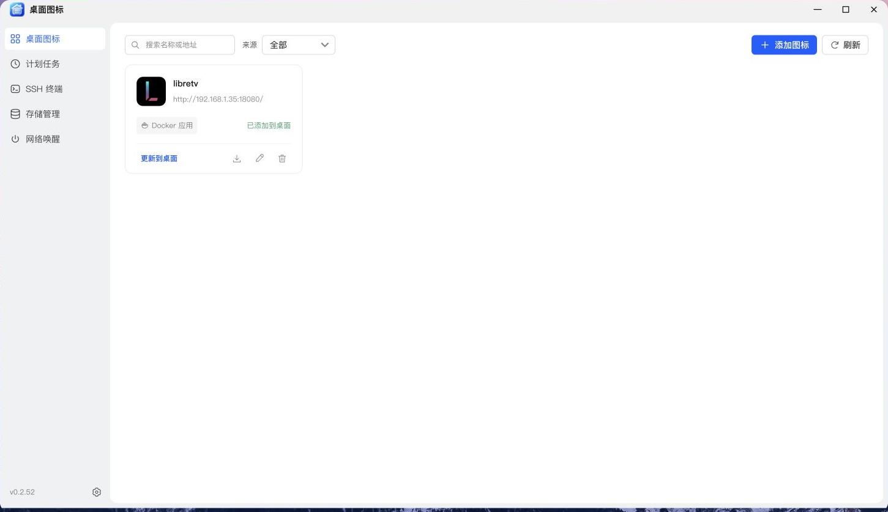
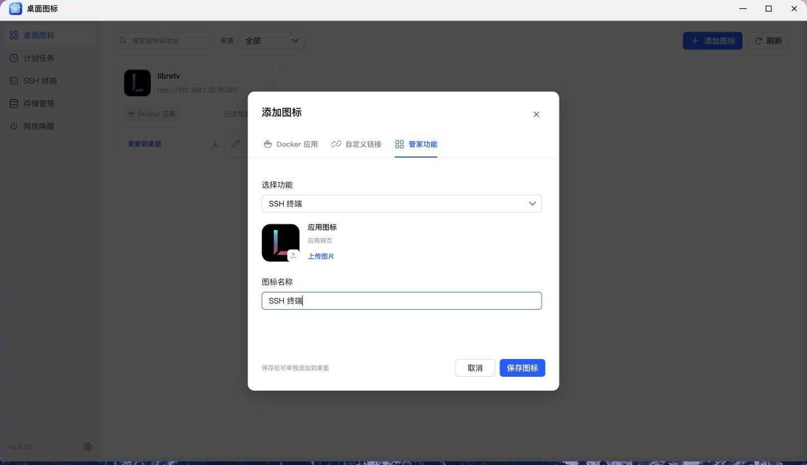
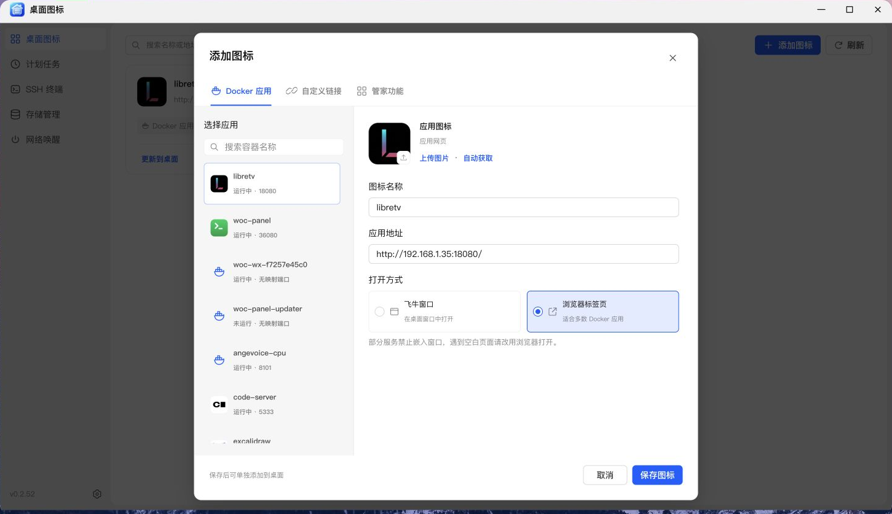

# NAS 管家——桌面图标教程

> 适用版本：v0.2.52 · 配图来自 NAS 真机浏览器。表单示例仅作演示，请按自己的环境填写。

本篇介绍 Docker 应用、自定义链接与 NAS 管家功能的桌面入口创建方法。

---

## 前言：创建的是入口

这里创建的是飞牛桌面图标。它负责打开已有服务或 NAS 管家的指定菜单，**不会替你部署 Docker 容器，也不会因为删除图标就卸载原服务**。

你可以把影音服务、笔记、下载工具、管理面板放到桌面，也可以直接创建 SSH 终端、计划任务等 NAS 管家菜单的专属入口，名称和图标都能按自己的习惯调整。

| 入口类型        | 适用情况                                          |
| :-------------- | :------------------------------------------------ |
| **Docker 应用** | 容器已在 NAS 上部署，希望自动读取应用信息和图标   |
| **自定义链接**  | 已有完整访问地址，希望自由设置名称和图片          |
| **NAS 管家**    | 将 SSH 终端、计划任务等作为无导航栏的独立窗口打开 |

## 把 NAS 管家菜单单独放到桌面

**不用每次先打开 NAS 管家，再切换菜单。** 例如，给 SSH 终端创建一个桌面图标，点击后直接进入连接列表，窗口里只保留 SSH 终端的内容，不显示主应用的侧边导航或手机底部导航。

> **说明：** 来源筛选和卡片标签显示 **NAS 管家**；添加或编辑图标面板中，对应的类型按钮目前显示 **管家功能**。

### 以 SSH 终端为例

1. 打开 **NAS 管家 → 桌面图标**，点击 **添加图标**；手机上点击筛选行右侧的 **＋**。
2. 选择 **管家功能**，在 **选择功能** 下拉框中选择 **SSH 终端**。
3. 检查自动填写的名称，需要时改成自己的名称，也可以上传自定义图标。此类型不需要填写应用地址或选择打开方式。
4. 点击 **保存图标**，回到卡片后再点击 **添加到桌面**，等待系统完成安装。也可以使用卡片上的下载按钮获取入口 `.fpk` 安装包，手动安装到同一台 NAS。
5. 从飞牛桌面打开新图标，即可进入独立 SSH 界面。**打开入口不会自动建立 SSH 连接**，选择连接并点击 **连接终端** 后才会登录。

### 可以创建哪些独立入口？

| 功能     | 打开后的内容                           |
| :------- | :------------------------------------- |
| SSH 终端 | 连接列表，连接后进入终端工作区         |
| 计划任务 | 任务列表及新增、编辑、执行、日志等操作 |
| 存储管理 | 扫描入口、空间分析、重复检查和文件整理 |
| 网络唤醒 | 设备列表、扫描、唤醒及已绑定的电源操作 |
| 系统设置 | NAS 管家的外观和使用偏好               |
| 桌面图标 | 图标管理列表及创建、编辑等操作         |

独立入口与主应用**共用同一份数据和配置**，不是另装一套 SSH 或存储工具；从任一入口修改后，其他入口读取的也是更新后的数据。它也不会修改主应用的默认菜单。

入口通过 NAS 管家的系统网关打开，不需要填写 NAS 内网 IP，内网 IP 改变后无需重建入口。它依赖同一台 NAS 上已安装的 NAS 管家，不能脱离主应用单独运行；仍需使用具有管理权限的飞牛账号，相关功能原有的 SSH、官方授权等要求也不变。

## 给 Docker 应用创建图标

1. 打开 **NAS 管家 → 桌面图标**。
2. 点击 **添加图标**，选择 **Docker 应用**。
3. 从应用列表中选择目标容器；手机上使用下拉选择，并支持搜索。
4. 检查自动填写的名称、应用地址和自动获取的图标。
5. 根据需要修改名称，或通过 **上传图片 / 自动获取** 调整图标。
6. 选择打开方式，点击 **保存图标**。
7. 回到图标卡片，点击 **添加到桌面**。

> **提示：** **保存与添加到桌面是两个步骤。**  
> 保存后先生成管理卡片，再通过卡片把入口添加到飞牛桌面。

容器没有映射 Web 端口时，需要补充正确的访问地址。不要把容器内部端口直接当成 NAS 对外提供服务的端口。

自动地址使用 NAS 可访问地址；不要把 `localhost` 当作手机或其他电脑访问 NAS 的地址。截图中的容器仅作表单演示，没有新建入口。

## 给自定义链接创建图标

选择 **自定义链接**，填写下面这些内容即可：

- **名称：** 使用容易辨认的短名称。示例：家庭服务台。
- **应用地址：** 填完整地址，包含协议和实际端口。示例：`http://192.168.10.20:8080/`。
- **图标：** 尽量使用清晰、接近正方形的图片。示例：自己上传的 PNG 图片。
- **打开方式：** 由目标网页是否允许嵌入决定。示例：飞牛窗口 / 浏览器标签页。

完成保存后，同样需要点击卡片上的 **添加到桌面**。

## Docker / 自定义链接的两种打开方式怎么选？

NAS 管家类型固定使用飞牛窗口，下面的打开方式选择仅适用于 Docker 应用和自定义链接。

### 飞牛窗口

希望应用像飞牛里的其他窗口一样打开，可以先试这个方式。

但部分网页禁止被嵌入，可能出现空白页或无法正常登录。这种情况下，编辑图标，改用浏览器标签页。

### 浏览器标签页

适合多数独立 Web 服务，尤其是登录流程、页面跳转比较复杂的应用。

**桌面入口不会自动为目标服务建立外网访问通道。** 例如，你填的是家庭局域网地址，手机在外面能否打开，还取决于它是否能访问该地址。

## 图标更新与日常管理

- **编辑后同步：** 修改名称、图片或地址后，回到卡片点击 **更新到桌面**。
- **快速查找：** 使用搜索框，或按 Docker 应用 / 自定义 / NAS 管家来源筛选。
- **删除入口：** 删除本应用创建的图标及桌面入口，不会删除对应容器和服务。
- **手机操作：** 添加入口使用筛选行右侧的 ＋；下载、编辑、删除位于卡片底部操作行。

## 常见问题

| 情况                       | 优先检查                                                       |
| :------------------------- | :------------------------------------------------------------- |
| 没有自动读到图标           | 服务是否提供可访问图标；也可直接上传图片                       |
| 地址自动填写后打不开       | 容器是否运行、Web 端口是否映射、地址是否可达                   |
| 飞牛窗口里显示空白         | 改为浏览器标签页，检查网页嵌入限制                             |
| 修改了图片，桌面仍是旧的   | 是否点击了“更新到桌面”；必要时刷新飞牛桌面                     |
| 手机外出后打不开           | 目标地址的网络可达性，不只是图标设置本身                       |
| 找不到 NAS 管家类型        | 添加面板中选择“管家功能”，列表来源筛选显示“NAS 管家”           |
| 独立入口打不开             | 确认同一台 NAS 上的 NAS 管家已安装并运行，且当前账号有管理权限 |
| SSH 入口打开后没有自动连接 | 正常行为；点击“连接终端”才会发起连接                           |

---

**推荐上手顺序：** 先选一个自己能正常访问的服务，完成“保存 → 添加到桌面 → 点击验证”，再批量整理其他入口。

[← 返回项目首页](../README.md) · [下一篇：计划任务 →](scheduled-tasks.md)  
开发者 / 发布者：[kaf](https://club.fnnas.com/home.php?mod=space&uid=91804)
