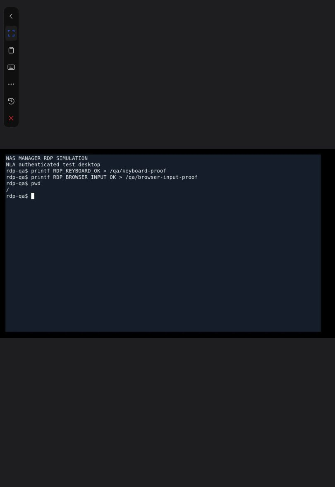

# RDP 远程桌面

在「远程连接」新增连接，协议选 RDP，填写 NAS 可访问的 Windows 地址、端口（默认 3389）、用户名和密码；域账号可填写域。点击连接后进入共用远程桌面工作区。支持鼠标、键盘、触摸、文字输入、文本剪贴板、特殊按键、全屏及会话连接日志。

目标必须启用远程桌面并允许该账号登录。使用 NLA，保留服务器证书校验；证书须受到 NAS 上 FreeRDP 信任。自签名证书需先建立可信证书配置，否则连接会拒绝，不会自动忽略验证。第一版不含音频、打印机、磁盘映射或 RDP 文件传输，SSH 文件管理保持独立。

## 实现与数据

浏览器使用 Apache Guacamole 1.6.0 官方客户端，NestJS 通过一次性短期票据接入 WebSocket，服务端使用保存的配置完成 guacd 握手。浏览器不能修改目标或注入握手参数。原生 guacd/FreeRDP 作为应用子进程按需启动，仅监听 127.0.0.1:14822，随应用停止。运行不需要 Docker、Java 或 Tomcat。

SQLite schema 23 增加按用户隔离的 `rdp_connections`，关联现有资产目录，支持现有配置备份和恢复。凭据沿用项目的本地明文存储约定；诊断日志和 WebSocket URL 不包含密码。连接日志只保留当前会话，关闭后清理。服务端最多 16 个 RDP 会话，每用户最多 4 个。

RDP 复用连接表单、卡片、下拉选择、密码显示组件、工作区侧栏、全屏工具、剪贴板面板和连接日志，没有新增独立 CSS。Guacamole 的画布和输入事件只封装在 `web/rdp-client.ts`，业务界面由 React 管理。

## 原生构建

构建容器仅用于开发时生成 Linux 原生组件；最终运行不使用容器。源码与许可证来自 Apache 官方，FreeRDP 及动态库来自 Debian Bookworm 软件包。导出脚本递归收集 ELF 动态依赖，包含加载器、许可证与每文件 SHA-256 清单。打包时检查清单及每个 ELF 的架构，缺少组件时直接失败。

```sh
mkdir -p /tmp/rdp-build
cp third-party/rdp/Dockerfile third-party/rdp/collect-runtime.py /tmp/rdp-build/
curl -fL https://archive.apache.org/dist/guacamole/1.6.0/source/guacamole-server-1.6.0.tar.gz -o /tmp/rdp-build/guacamole-server-1.6.0.tar.gz
# x64；ARM64 使用 TARGET_ARCH=arm64，输出改为 tools/rdp/arm64
 docker build --platform linux/amd64 --build-arg TARGET_ARCH=x64 -t nas-manager-rdp:x64 /tmp/rdp-build
id=$(docker create nas-manager-rdp:x64 /bin/true)
mkdir -p tools/rdp/x64
docker cp "$id":/rdp/. tools/rdp/x64/
docker rm "$id"
npm run pack
# 完成 ARM64 构建后：TARGET_ARCH=arm64 npm run pack
```

服务器源码 SHA-256：`8bc45675da96d7b6f39728160181e3d4ff3c08f460f6d26de5805b642bf13f2b`。
客户端源码 SHA-256：`81f9fd5a7b4377fb0ee295d0d4fec92e9667f2aafaa3d0ed8937f535deabdee4`。
均已与 Apache 官方校验文件比对。`third-party/guacamole/index.js` 由官方 `guacamole-common-js/src/main/webapp/modules/*.js` 按文件名排序连接，并追加 ESM 默认导出，保留 LICENSE/NOTICE。

本次原生运行组件压缩约 x64 67 MiB、ARM64 62 MiB，展开约 175 MiB、150 MiB。具体 FPK 大小还包含现有应用。

## 验证边界

已覆盖协议分片、Unicode、大小限制、服务端凭据映射、拒绝握手注入、票据重放/来源校验、跨用户隔离、数据库迁移、配置恢复、React 会话取消清理、运行组件启动参数与资源释放。NAS 上验证 x64 原生启动和 RDP 插件握手，ARM64 已交叉编译并检查全部 ELF 架构，尚无 ARM 真机运行验证。

用户暂无 Windows 设备，因此 Windows 登录、实际画面、输入及剪贴板互通尚未实机验收，不能视为已完成端到端兼容验证。

参考：[Apache Guacamole RDP 配置](https://guacamole.apache.org/doc/1.6.0/gug/configuring-guacamole.html)、[原生安装](https://guacamole.apache.org/doc/1.6.0/gug/installing-guacamole.html)。

## 2026-10-26 NAS 验收

- 通过 SSH 停止服务、替换 dist/server 与原生 tools/rdp、启动；没有调用应用中心安装/卸载，没有清空数据。
- 实际运行版本仍为 0.3.1；本次未修改应用中心登记版本。
- 全部 760 项测试通过，类型检查、ESLint、生产构建和两个架构的 FPK 打包成功。
- 服务状态正常；state、SSH、VNC、RDP 连接接口正常。原有 2 个 SSH 与 1 个 VNC 配置保留。
- NAS 本机由应用按需拉起 guacd；通过管理员身份及一次性票据连接 WebSocket，完成真实原生 RDP 协议握手，并对测试不可达端口返回预期错误及 5 条诊断事件。临时连接与会话已删除。
- SQLite `user_version=23`，`integrity_check=ok`，`foreign_key_check` 为 0 条。
- 安装包：`build/deskicons/0.3.1.fpk` 约 90 MiB；`build/deskicons-arm64/0.3.1-arm64.fpk` 约 85 MiB。
- 无 Windows 测试设备；未宣称 Windows 登录、画面、剪贴板及移动端远程操作已真机验证。ARM64 为交叉编译和 ELF 校验，尚未在 ARM NAS 执行。

现有依赖审计仍报告 NestJS 链路中的 body-parser / multer 高风险公告（压缩请求体及异步文件筛选的拒绝服务问题）。本次 RDP 没有新增这些依赖，也未将“测试通过”表述为依赖零漏洞；框架依赖升级需单独验证现有上传与请求处理行为。

## 2026-10-26 完整模拟验收

补充使用 FreeRDP Shadow + Xvfb + xterm 构建独立测试对端，启用 NLA/SAM 认证，Docker 只在测试期间使用，端口映射限于 NAS 本机 `127.0.0.1:13389`。应用仍使用已部署的 guacd、NestJS 认证网关和浏览器 Guacamole 客户端。测试证书只按精确指纹临时信任，保留 `ignore-cert=false`，完成后移除。

| 验证项 | 结果与证据 |
| --- | --- |
| 错误密码 | 真实 NLA 认证拒绝，前端收到错误指令 |
| 正确密码与真实画面 | 登录成功，收到 size、img、blob、sync 等指令，浏览器显示 xterm 测试桌面 |
| 键盘协议 | 通过 RDP 输入执行命令，测试对端文件内容为 `RDP_KEYBOARD_OK` |
| 浏览器文字输入 | 应用文字输入组件发送命令，对端文件内容为 `RDP_BROWSER_INPUT_OK` |
| 浏览器普通键盘 | 直接在画布输入 `pwd`，远端显示工作目录 `/` |
| 鼠标 | 发送位置 410×210，对端 xdotool 读取位置一致 |
| 全屏 | 进入全屏、显示悬浮工具栏，并通过退出按钮返回；本次自动化未确认原生 Esc 行为 |
| 断开与重连 | 断开后显示“连接已结束”，点击重新连接恢复会话，最后关闭标签完成清理 |
| 剪贴板 | 未能验收；Shadow 服务未实现 CLIPRDR，不能据此判定应用剪贴板成功或失败 |
| 清理 | 删除临时连接、结束临时会话、移除证书信任、停止测试容器，13389 不再监听；保留用户自己的连接 |

测试对端构建文件位于 `tests/fixtures/rdp-shadow/`，不进入应用运行依赖，也不随普通单元测试启动。截图保存于 `docs/qa/rdp/2026-10-26/rdp-simulation.png`。



结论：已验证从浏览器到 NAS 网关、原生 guacd、RDP/NLA 对端及输入回传的完整链路有效。仍需 Windows 真机验收系统兼容、账户策略、证书部署与剪贴板互通；没有将 Linux Shadow 对端视为 Windows 实机。

参考：[FreeRDP Shadow 官方实现](https://github.com/FreeRDP/FreeRDP/blob/2.11.7/server/shadow/shadow_server.c)、[维护者对 Shadow 剪贴板限制的说明](https://github.com/FreeRDP/FreeRDP/discussions/9272)。

本轮界面检查同时将共用全屏工具栏名称改为“全屏远程桌面工具栏”。23 项相关界面测试通过，两种架构重新打包成功，按 SSH 流程更新 NAS 前端。运行仍为 0.3.1，未改变应用中心登记版本。部署后服务正常，原有用户 RDP 配置保留，数据库完整性为 ok、外键错误为 0；本地与 NAS 的 `dist/index.html` SHA-256 一致。

## 2026-10-27 移动端日志面板对齐

修复 RDP 普通模式只挂载日志/剪贴板内容、遗漏公共 `terminal-assets` 外层的问题。日志与剪贴板现在与 VNC 使用相同的侧板容器、移动端底部面板规则、标题栏和滚动区域；全屏模式也补齐面板语义标签，没有新增 CSS。

新增日志与剪贴板在普通/全屏模式之间切换的回归测试，修复前能够复现缺失容器，修复后相关 28 项测试通过。ESLint、类型检查、两种架构构建和打包通过。在浏览器的 390px 宽、844px 高 iframe 视口中对照 RDP 与 VNC，底部侧板位置、宽度、圆角和标题栏一致；本次没有连接实体手机。截图见 `docs/qa/rdp/2026-10-27/mobile-log-panel.png`。本地测试连接和临时页面已清理。

通过 SSH 停止、替换前端、启动并验收 NAS，保留数据。运行版本仍为 0.3.1，应用中心登记版本未修改；服务状态及 RDP 接口正常，SQLite 完整性 ok、外键错误 0。本地与 NAS 前端入口 SHA-256 均为 `74a929d18fc5291fd27be42f3558dcdb1a7e1a058a161fa77fad93377930d770`。

## 2026-10-27 其余界面统一

将远程桌面的连接状态提示和文字输入行抽为 `web/remote-desktop-surfaces.tsx` 公共组件，RDP 与 VNC 同时复用：连接中显示公共加载动画，失败时使用公共错误样式及 alert 语义，输入区统一为输入框与发送按钮，发送追加回车，断线时保留草稿并拒绝发送。没有增加 CSS。

特殊按键下拉菜单统一为普通模式使用 Semi 默认浮层容器，全屏模式挂载到远程桌面全屏区域。补充了状态切换、普通/全屏容器、回车发送及断线阻止发送的回归检查。相关 31 项界面检查通过，全量 766 项测试通过，ESLint、类型检查和两种架构打包通过。

本轮已通过 SSH 停止服务、替换前端并启动，保留现有数据。NAS 实际运行 0.3.1，应用中心登记版本未变；服务、state、RDP/VNC 连接接口正常，SQLite 完整性 ok、外键错误 0。前端入口本地与 NAS SHA-256 一致：`8b359e75eeccd3e63c1392dee09acc733dc1e93b4e7df5931402d16ab52a80ca`。

## 2026-10-27 全屏退出及活动侧板状态对齐

RDP 与 VNC 对齐全屏生命周期：捕获 Esc 退出当前远程桌面全屏；全屏区域存在已打开的 dialog 时让弹窗优先处理 Esc；切换到其他标签或卸载工作区时退出自己占用的全屏；移除事件监听，不退出其他元素的全屏。退出失败时沿用相同提示。

侧板通过最新回调按活动标签通知显示状态，普通重渲染和回调函数身份变化不再重复通知；选中新标签时即使没有打开侧板，也通知工作区清理前一标签的侧板状态。返回原标签时恢复原有面板，与 VNC 保持一致。

新增全屏 Esc、弹窗优先、全屏归属、卸载清理、侧板回调身份、标签状态恢复及空侧板激活的回归检查。相关 29 项测试通过，全量 770 项测试通过；ESLint、类型检查、x86 与 ARM64 打包成功。浏览器 390×640 的独立 iframe 视口实测：Esc 从全屏回到普通工作区；A 标签打开日志、切到 B 后隐藏、回到 A 后恢复。此为本地界面交互验收，使用临时不可达 RDP 配置，不涉及 Windows 画面兼容测试。测试页面及配置已清理，截图见 `docs/qa/rdp/2026-10-27/behavior-panel-restore.png`。

通过 SSH 停止、替换前端、启动并验收 NAS，保留应用数据。实际运行版本仍为 0.3.1，未修改应用中心登记版本；服务、state、RDP/VNC 连接接口正常；SQLite 完整性 ok、外键错误 0。本地与 NAS 前端入口 SHA-256 均为 `7be2274cfd82e0aa7ac8f15294ab249209ab255a41f57c37a2d6fbe016ad5545`。

## 2026-10-27 错误提示布局冲突修复

移除远程桌面错误提示上的 `.notice` 横幅布局类，保留 `.remote-desktop-status.error`，与 `.notice.error` 共用 foundation 中同一组错误颜色。远程提示的居中、16px 内边距、12px 圆角由远程桌面公共容器负责，并使用透明边框保持状态切换尺寸稳定。没有复制错误调色规则，也没有修改其他页面提示框的布局。

新增防止横幅布局类再次混入的回归检查，相关 29 项测试通过，ESLint、类型检查、x86/ARM64 打包成功。浏览器实测 RDP 垂直和水平中心偏移均为 0；VNC 垂直中心偏移 0、水平偏移小于 0.01px，均为16px 内边距及12px 圆角。修复前错误提示 margin-bottom 为18px、圆角6px、内边距11px 14px，实际贴近底部；修复后上下自动外边距相等。截图见 `docs/qa/rdp/2026-10-27/error-centered.png`，临时验收连接已清理。

已按 SSH 停止、替换前端、启动更新 NAS，保留数据。首次固定延时探测时接口尚未就绪，复查服务启动日志并重试后验收成功：实际运行0.3.1，state、RDP/VNC 连接接口正常，SQLite 完整性ok、外键错误0。应用中心登记版本未改动。本地与 NAS 入口 SHA-256 一致：`ede420a99ed6c5d20262d28a6c266c51638039370645a97ed7f2b03a41b6455a`。

## 2026-10-28 按键释放及连接日志阶段修复

RDP 输入适配器记录实际发送过 keydown 的物理按键。切换到非活动标签后，Guacamole Keyboard.reset() 产生的 keyup 仍会释放这些按键；未发送过的按键和重复 keyup 不再影响远端状态。覆盖 Ctrl/Alt/普通按键在标签切换后的释放、非活动按键在重新激活后的无匹配 keyup，以及断开前释放 Windows 键等场景。

原生 guacd 的 ready 只代表网关握手完成，尚不代表目标认证或桌面已就绪。后端在该阶段改为 protocol/info：“RDP 网关握手已完成，等待远程桌面响应”；客户端收到首轮更新时记录“已收到远程桌面更新”，不将握手就绪记成桌面连接成功。模拟 ready 后返回认证失败的回归检查确认不再产生 desktop/success 记录。

定向 18 项检查通过，全量 776 项测试通过，ESLint、类型检查、x86/ARM64 打包成功。通过 SSH 停止服务、替换 dist/server、启动更新 NAS，保留数据，未走应用中心安装或卸载；实际运行及包版本仍为0.3.1，应用中心登记版本未修改。

NAS 原生验收使用已部署 guacd 连接一次性本机不可达测试端口，实测日志依次为 session/success、websocket/success、protocol/info、network/error、disconnect/info，没有 desktop/success。临时会话和配置已清理，连接接口正常，SQLite 完整性ok、外键错误0。按键回归使用适配器事件模拟，未声称已完成 Windows 物理设备兼容验收。

本地与 NAS 文件校验一致：前端入口 `82a04f4b2e4c1847d1bc02e0188f3b45bf95a4d91bc582025e870bf34f2684a2`；后端 RDP transport `66c13ce10ce39ba6ca9af9fba1f91a7d127a322fa8dfb209290abab93c1156a0`。

## 2026-11-04 安全模式与证书策略

参考 Apache Guacamole 的 `security`、`ignore-cert`、`cert-tofu` 参数以及 Remmina/FreeRDP 的连接配置方式，移除固定 NLA 和固定证书策略。新增连接默认“自动协商 + 严格验证”，可选 NLA、TLS、旧版 RDP；证书策略可选严格验证、首次信任并记住、忽略证书校验。采用现有 NativeSelect、公共表单和说明文字，没有新增 CSS。

首次信任使用引擎自带 TOFU，自动接受首次未知证书并保存，后续匹配检查。guacd 的 HOME 和 XDG_CONFIG_HOME 指向应用数据目录 `rdp/` 与 `rdp/.config/`，权限 0700，运行文件替换不会删除信任记录；不使用系统 root 的证书记录。忽略验证仅在用户显式选择时启用。安全模式和证书策略随连接配置备份、恢复，证书信任文件不随配置备份导出。

SQLite 从26迁移到27，已有连接保留 NLA + 严格验证，不自动降低其证书策略。旧客户端更新连接时省略新字段会保留已保存设置。连接日志与错误提示报告实际配置，避免继续固定显示“NLA / 校验已启用”。

验证：全量842项测试通过，类型检查、生产构建、ESLint通过。NAS 原生 guacd/FreeRDP 对临时本机 TLS 协商端点实测：严格验证拒绝自签名；TOFU首次接受并写入记录；引擎重启后相同证书仍接受；更换证书后拒绝；显式忽略验证允许测试证书。测试脚本 `tests/fixtures/rdp-security-native.mjs` 仅验证真实 TLS/证书阶段及后续 NLA 流量，不模拟完整 Windows 桌面或声称完成 Windows 兼容验收。临时数据、证书与进程已清理，不修改用户的连接记录。

375×812 浏览器检查：新增选择框均使用公共尺寸（271×40），弹窗无横向溢出，内容滚动、底部操作固定。未保存测试表单。

SSH停止、替换dist/server、启动后，NAS实际运行版本保持0.3.6，应用中心登记版本未修改；数据库27，完整性ok、外键错误0，原有图标1、SSH连接1、命令173及其他配置数量不变。state、连接、计划任务、存储、通知和设置等接口正常。替换前的运行文件与数据库备份保留在NAS `/tmp/rdp-security-backup.*`。

参考：[Guacamole RDP配置](https://guacamole.apache.org/doc/gug/configuring-guacamole.html)、[Remmina源码](https://gitlab.com/Remmina/Remmina/-/blob/master/plugins/rdp/rdp_plugin.c)、[FreeRDP证书参数](https://github.com/FreeRDP/FreeRDP/wiki/CommandLineInterface-%28possibly-not-up-to-date%2C-check-application-help-text-for-most-up-to-date-version%29)。
