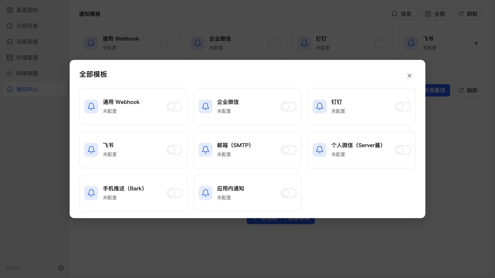

# 全部通知模板验证

日期：2026-11-10

## 变更

- 消息按钮旁增加图标加文字的“全部”入口。
- 复用公共 large ReactDialog、cards 网格与同一套 CompactCard 渲染，展示八种内置渠道及已配置模板；没有新增 CSS。
- 总览与编辑弹窗互斥，取消或保存后返回总览；离开通知菜单关闭弹窗。
- 移除表单通知渠道选择，渠道由内置卡片或已保存模板确定；已移除渠道的旧模板禁止保存，避免隐式转换渠道。
- 总览中的更多菜单挂载在当前弹窗中。

## 检查结果

- 新增总览交互测试在旧实现下因缺少入口失败，修改后通过。
- 通知 UI 11 项通过；全量 `npm test` 1008 项通过；生产构建、类型检查、ESLint 与 diff 检查通过。构建保留现有产物体积提示。
- 首次全量测试与构建并行，生成目录被重建导致测试失败；已顺序重跑完整测试，最终失败 0 项。
- NAS 浏览器确认总览八张卡片、邮箱编辑无渠道选择、只打开一个弹窗、取消后回到总览。
- 375px 小屏幕公共底部弹窗宽 375px；滚动内容宽 369px，无横向溢出；内容高 896px、可视区 558px，超出部分内部滚动。

## NAS 更新

SSH 停止、备份、替换运行文件并启动，保留全部应用数据。运行版本 0.4.2；应用中心登记信息未变，本次未生成安装包。

更新前数据库备份：`/tmp/notification-center-pre-1794280039294.sqlite`。

更新后 schema 33，integrity_check 为 ok，外键错误 0；原模板、投递记录和业务配置核对通过。通知、SSH、VNC、RDP、ADB 接口 HTTP 200。

