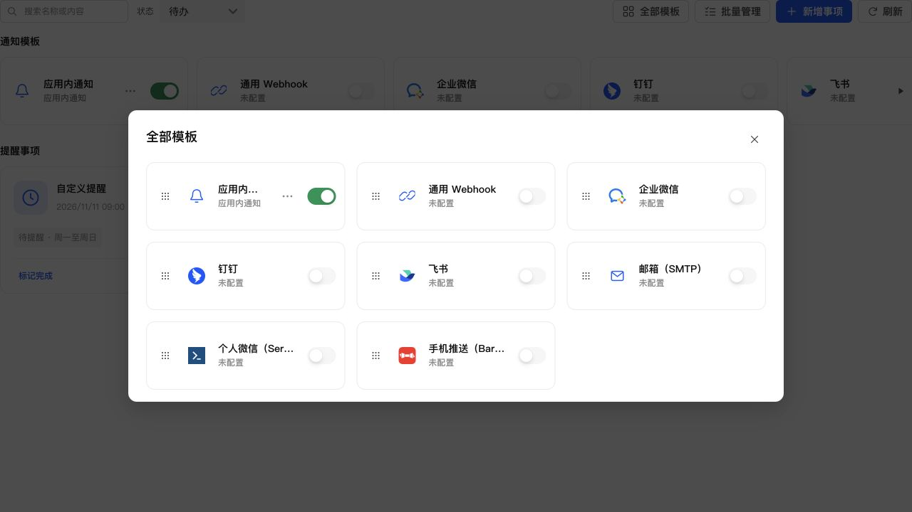

# 通知模板图标移除外层底色

在公共 CompactCard 图标容器规则中设置 background: transparent。保留品牌图标本身颜色、原尺寸、布局及按钮交互；不修改其他功能卡片的图标底色，不新增页面专用样式。

45 项通知 UI 测试、类型检查、生产构建、格式及 diff 检查通过。浏览器使用真实组件与生产 CSS 检查全部模板，八个容器的实际背景均为 rgba(0,0,0,0)，本地渠道图像正常显示。未进行手机真机操作。

通过 SSH 停止、备份、替换运行文件、启动更新 NAS，保留数据，未使用应用中心安装/卸载。运行版本 0.4.2，数据库 35，登记版本不变。关键接口和生产资源正常，数据库完整性 ok、外键错误 0，原模板及投递数据校验一致，提醒仍为 1 条。

- 数据库备份：`/tmp/notification-center-pre-1794322791918.sqlite`
- 运行备份：`/tmp/adb-runtime-backup.Q4hVyI`
