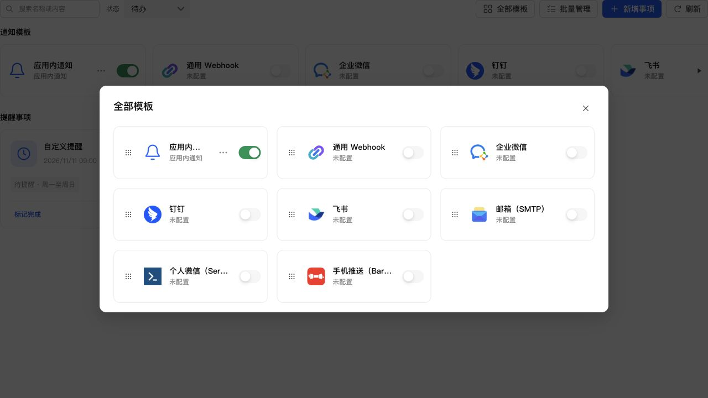

# 通知模板彩色图标与尺寸

通用 Webhook、邮箱使用公共 SVG 图标中的彩色链接及信封。所有通知模板图标统一为 32px，图片与 SVG 复用同一条公共尺寸规则，外层保持透明；保留卡片间距及按钮布局。

45 项通知 UI 测试、生产构建、相关 ESLint 和 diff 检查通过。浏览器使用真实 React 组件、生产 CSS 与模拟数据验证：八个图标实际尺寸均为 32×32px，外层背景全部透明。未进行手机真机操作。

已通过 SSH 停止、备份、替换运行文件、启动更新 NAS，保留应用数据。运行版本仍为 0.4.2，应用中心登记版本未变。关键接口及生产资源正常，数据库版本 35，完整性 ok，外键错误 0，原模板、投递数据校验一致，提醒仍为 1 条。

- 数据库备份：`/tmp/notification-center-pre-1794322976455.sqlite`
- 运行文件备份：`/tmp/adb-runtime-backup.i2Hs14`
