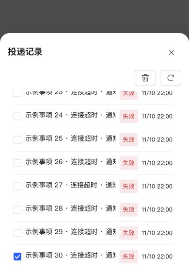

# 投递记录移动端适配

投递记录弹窗复用存储管理的公共 list-management-dialog、dialog-scroll-surface 和 large/workspace 尺寸，操作区改用 StorageToolbar。批量删除及刷新按钮统一使用公共图标、文字标签、悬浮说明和移动端按钮规则。

投递记录列表移除旧 history-mobile-list，沿用公共单行 RecordList、开头多选框、状态、日期及长名称滚动。存储管理内嵌投递列表同步复用，不新增独立 CSS。模板和事项筛选、分页及批量删除接口保持原逻辑。

## 验证

- 新增回归测试先复现未使用公共列表管理容器的问题，修复后通知 UI 与投递记录 UI 40 项测试通过。
- 覆盖模板筛选、移动端无桌面表格、公共列表容器、选择后可批量删除及刷新重新读取。
- 修改文件 ESLint、类型检查、生产构建及 diff 检查通过。
- 真实 React 组件、生产样式、本地 30 条模拟记录，在 390×568 浏览器视口选择第 30 条：外层 overflow=hidden 且不滚动，列表独立滚动，工具栏仍可见，批量删除按钮可用。未实际删除 NAS 数据，未操作手机真机。

## NAS 更新

通过 SSH 停止、备份、替换运行文件、启动，保留现有数据，未进行应用中心安装/卸载。运行版本仍为 0.4.2，应用中心登记版本不变。

- 数据库备份：`/tmp/notification-center-pre-1794319240372.sqlite`
- 运行备份：`/tmp/adb-runtime-backup.qC9eSR`
- 关键接口正常，生产入口资源完整；数据库版本 34，完整性 ok，外键错误 0。
- 模板及投递数据完整记录校验一致，原提醒仍为 1 条，现有配置数量保留。
