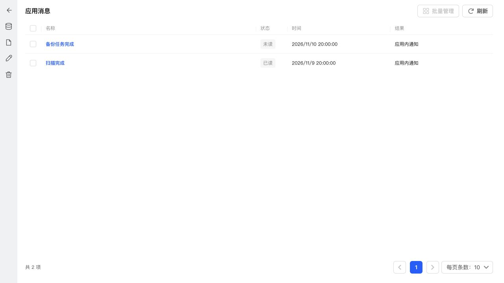
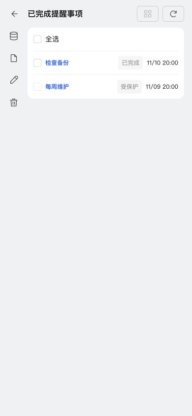

# 通知与提醒的应用清理

## 实现

应用清理增加“应用消息”“已完成提醒事项”，复用公共表格、移动端单行列表、详情弹窗、批量管理、选择和分页，没有新增 CSS。

- 应用消息独立保留最近 200 条，可在应用清理配置；结束的外部渠道投递仍默认 200 条，分别统计和清理。待发送和发送中记录保留。应用消息中包含未读消息，清理确认明确提示。
- 已完成提醒默认保留最近 100 条，只清理已完成单次提醒，保护待办、暂停未完成事项和所有重复提醒。重复提醒显示“受保护”，不能选择。
- 应用消息原有批量删除改用独立类别；应用内模板记录入口打开公共应用消息弹窗；外部投递列表（包括模板、事项筛选）统一排除应用内消息，避免可见记录与删除范围不一致。
- 不增加业务表，数据库 35 → 36 为历史上限表增加两列。保留旧上限及现有数据。提醒事项总量上限仍为每账号 500 条。

## 验证

1072 项测试通过。覆盖渠道及用户隔离、原子批量删除、进行中投递保护、重复提醒保护、独立自动清理与手动清理、迁移及重复启动、详情、公共 UI 映射和 API 权限。完整类型检查、生产构建、全项目 ESLint 与修改文件格式检查通过。

浏览器使用真实 StoragePage、公共组件、生产 CSS 和模拟数据验证 1280px 桌面表格及 390px 小屏幕列表，均无页面横向溢出。选择列在前，受保护提醒不可选，详情弹窗正常。未使用手机真机。

## NAS 更新

通过 SSH 停止、备份、替换运行文件、启动，保留应用数据，未使用应用中心安装或卸载。运行版本仍为 0.4.2，应用中心登记版本不变。

- 数据库版本 36，完整性 ok，外键错误 0。
- 原模板和投递记录校验一致，原提醒仍为 1 条。
- 关键接口和生产资源正常；清理共 12 类，两个新增详情接口 HTTP 200，默认上限分别为 200 与 100。
- NAS 验收只读，未向任何真实渠道发送测试通知，未执行真实数据清理。
- 数据库备份：`/tmp/notification-center-pre-1794324187281.sqlite`
- 运行文件备份：`/tmp/adb-runtime-backup.PD7zCS`
