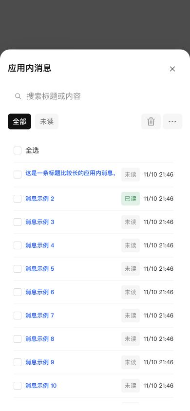

# 通知中心图标及移动端应用消息

通知中心使用共享消息气泡图标，桌面主导航与移动端“更多”菜单一致；应用消息保留铃铛图标。公共图标目录统一提供图形，无新增 CSS。

应用消息复用 terminal-list-view 的公共移动端工具栏布局：搜索一行，全部/未读筛选与操作按钮下一行。列表使用公共紧凑单行 RecordList，选择框在开头，移除 history-mobile-list 造成的额外留白和灰底。消息详情保留换行、文本滚动与已读操作；返回按钮使用普通公共工具栏，不再被列表的移动端网格拉伸。

## 验证

- 图标阶段导航与通知 UI 测试 45 项通过；最终通知 UI、投递记录 UI 与导航测试共 43 项通过。
- 回归测试覆盖移动端单行列表、公共布局、选择后批量操作可用、打开详情标记已读以及返回列表。
- 修改文件 ESLint、类型检查、生产构建通过。
- 390×844 浏览器视口使用真实组件、生产 CSS 和本地模拟消息验证：长标题、20 条列表滚动、选择状态、详情换行、返回后已读状态。未发送外部通知，未进行手机真机操作。

## NAS 部署验收

最终通过 SSH 停止、备份、替换运行文件、启动；未进行应用中心安装/卸载。运行版本仍为 0.4.2，应用中心登记版本未修改。

- 数据库备份：`/tmp/notification-center-pre-1794318413391.sqlite`
- 运行文件备份：`/tmp/adb-runtime-backup.v5afNz`
- 关键接口正常，生产引用资源完整；数据库版本 34，完整性 ok，外键错误 0。
- 最终部署前后模板完整记录校验一致，模板 1 条、投递记录 0 条、提醒 1 条；既有配置保留。
