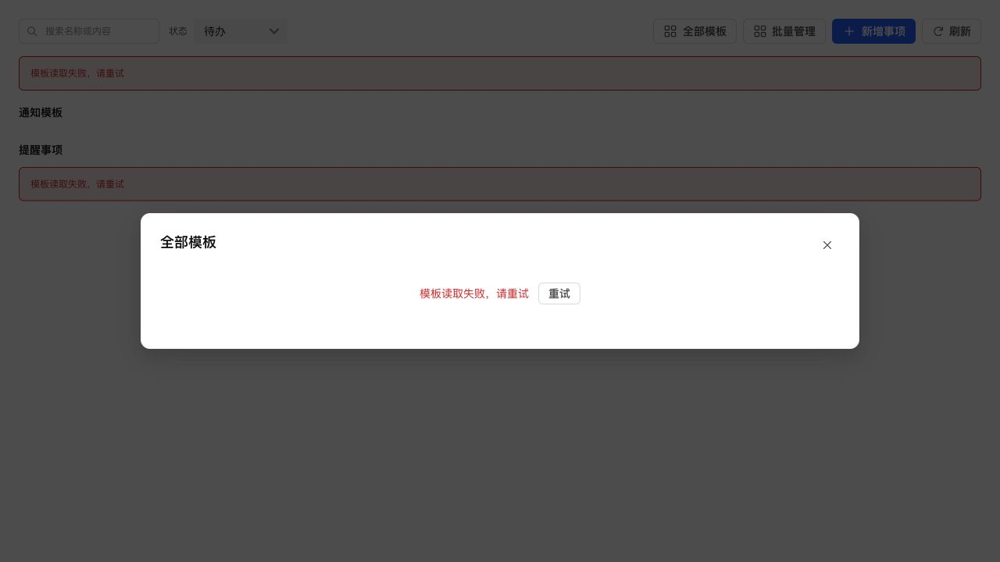
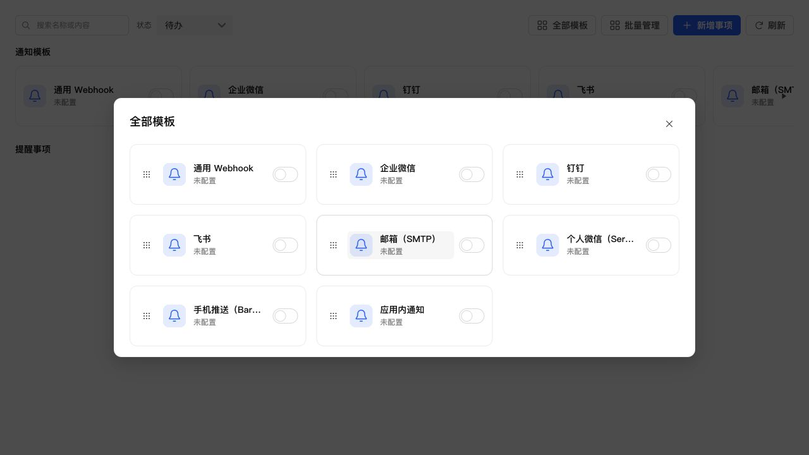

# 通知中心三项状态问题修复

## 修复内容

1. 排序保存尚未完成时切换菜单或刷新，列表读取先等待保存请求结束，再读取服务器顺序。保存失败会提示并恢复服务器状态，避免服务器与界面排列不一致。
2. 连续打开消息时，将后续已读请求放入队列并合并重复待处理 ID，每批最多 200 条。前一批失败仍继续处理后续消息；卸载界面时清理待处理队列，避免继续更新已关闭界面。
3. 首次读取模板失败时，不再在顶部或“全部模板”内显示默认未配置卡片。弹窗复用公共错误反馈与按钮样式，直接显示错误及重试入口；重试同时刷新提醒区域的模板状态，恢复后清除错误。再次读取失败时保留已加载的列表，暂停排序，等待重试。

服务端和数据库结构未变，未新增独立样式。

## 验证

- 三项问题均先通过针对性测试复现，修复前对应回归断言失败，修复后通过。补充排序保存失败后返回菜单、第一条已读失败仍处理下一条、重复打开待处理消息合并等场景。
- 最终全量 1037 项测试通过，通知界面 32 项测试通过；TypeScript、前端契约审计、生产构建和 ESLint 通过。
- 本地浏览器使用真实通知页面组件和生产 CSS，模拟模板读取失败，检查弹窗错误反馈；点击重试后恢复八张内置卡片，页面与弹窗的错误提示均清除。
- 直接打开完整生产 dist 页面，导航和错误反馈正常渲染，不再出现初始化白屏。本地静态服务器不提供业务 API，此检查只用于验证生产包启动，不作为 NAS 登录界面完整业务验收。
- 本次未做手机真机验收。

错误状态及重试后的本地测试截图：

## NAS 更新

已按既有 SSH 停止、备份、替换、启动流程保留数据更新，未走应用中心安装路径。运行版本仍为 0.4.2，应用中心登记版本未变。

- 数据库备份：`/tmp/notification-center-pre-1794302634002.sqlite`。
- 运行文件备份：`/tmp/adb-runtime-backup.4sFYIl`。
- 数据库版本仍为 34，完整性正常，外键错误 0。
- 原配置数量不变，模板和投递记录校验通过，原有 1 条提醒保留；版本和关键业务接口正常。
- 生产资源引用完整，React 核心包未反向导入 ui-vendor；本地与 NAS HTML SHA256 均为 `b9acedb06068bca4273d9e8753f598925050c5e88ecd91b77c1394d961f76d6b`。
