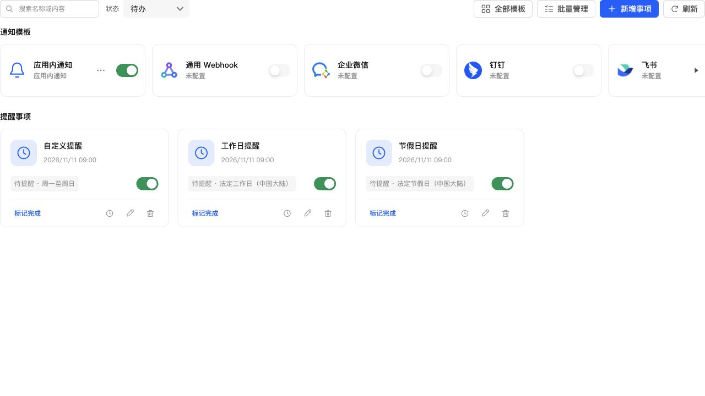
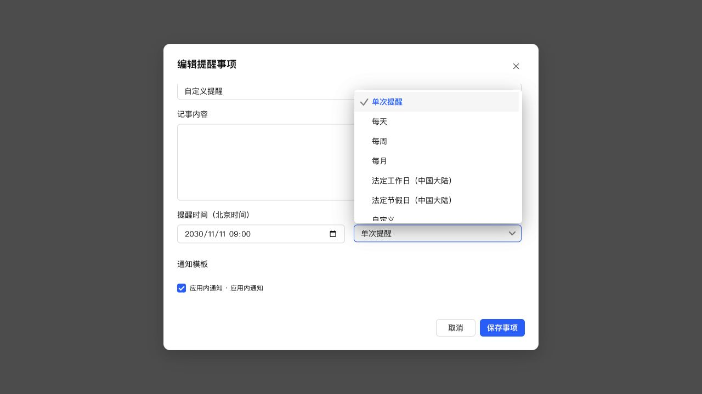
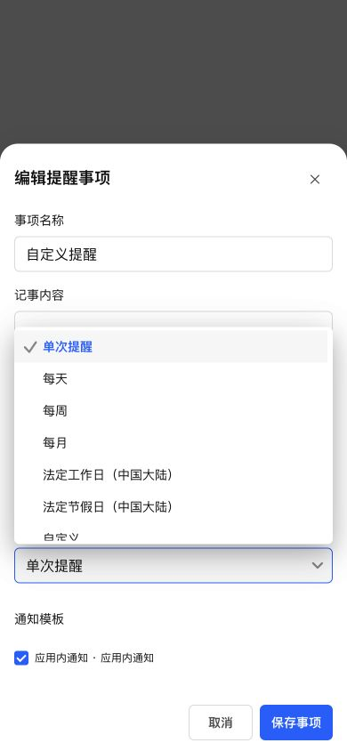

# 提醒事项按钮与下拉菜单

## 投递记录按钮

卡片组件单独维护图标映射，缺少提醒事项使用的 clock，导致按钮存在但 SVG 为无效路径，看起来像没有按钮。移除该映射，改用公共图标库。桌面和小屏幕均确认时钟图标可见，点击打开投递记录，空记录沿用公共空表格和分页策略。

## 下拉菜单裁切

复现时弹窗可见范围为 y=80～640，而下拉层展开到 y=692；虽然仍在 720px 的浏览器视口内，但被弹窗裁切。公共 NativeSelect 现在在展开时按弹窗与视口的交集测量可用空间，空间不足时调整上下方向，并将弹层和选项滚动区高度一起限制在可用范围内。沿用 Semi Select 和现有公共样式，不修改弹窗尺寸或放开外层裁切。

桌面复测弹层为 y=164～408，位于弹窗内。390px 小屏幕复测弹层为 y=367.6～611.6，位于底部面板内，无页面横向溢出。末尾“自定义”可滚动选择，选择后正确显示周几选项。

## 验证及部署

新增回归测试先复现无效图标和弹窗内错误展开方向，修复后通过。全项目 1076 项测试、类型检查、生产构建、ESLint、修改文件格式检查与 diff 检查通过。浏览器使用真实组件、生产 CSS 和模拟数据，未使用手机真机或发送真实通知。

已通过 SSH 停止、备份、替换运行文件、启动更新 NAS，保留应用数据。运行版本仍为 0.4.2，应用中心登记版本不变。数据库版本 36，完整性 ok、外键错误 0，原模板和投递数据校验一致，原提醒仍为 1 条。关键接口及生产资源正常。

- 最终数据库备份：`/tmp/notification-center-pre-1794324799922.sqlite`
- 最终运行文件备份：`/tmp/adb-runtime-backup.Dp9oPo`
- 按钮修复阶段数据库备份：`/tmp/notification-center-pre-1794324397319.sqlite`
- 按钮修复阶段运行备份：`/tmp/adb-runtime-backup.ulZ4Xc`
