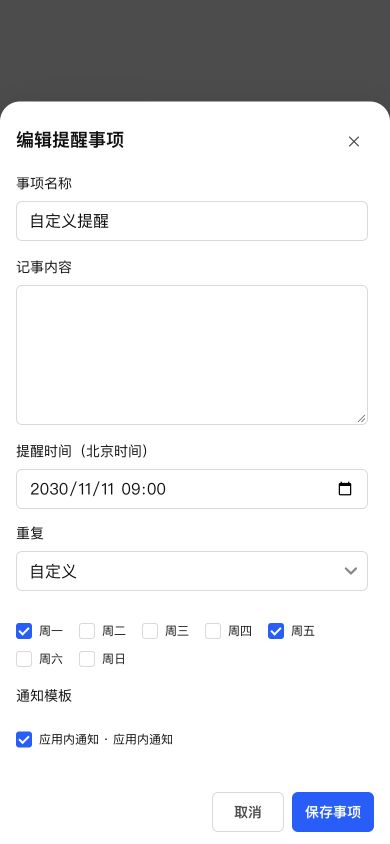
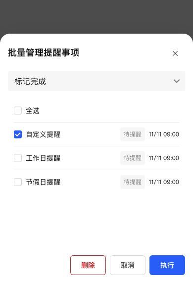
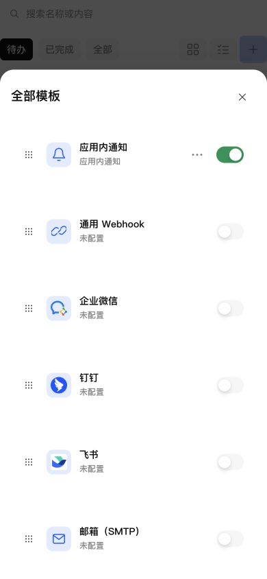
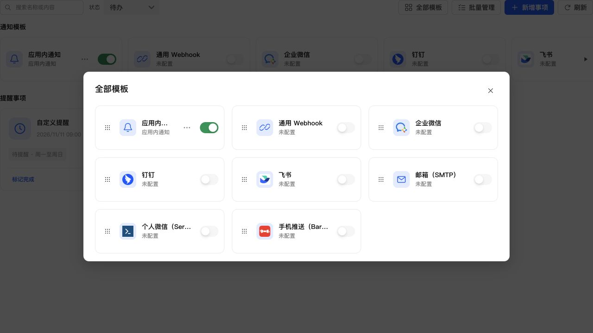

# 提醒重复规则、批量删除与渠道图标验收

## 最终行为

- 重复新增法定工作日（中国大陆）、法定节假日（中国大陆）及自定义周几；周一至周日至少选一天，使用原提醒时间的北京时间。工作日包括补班，节假日只匹配公告放假日期，普通周末不自动算作节假日。
- 数据库迁移到 35，保留旧提醒全部字段，新增 weekdays=[]。修改周几重新计算排程，暂停恢复保留选择；旧单次、日、周、月规则不变。
- 日历内置 2026、2027 年，由 holiday-cn 提供，原数据附国务院公告出处。日历缓存位于应用数据目录 reminder-calendars。启用日历提醒时每 6 小时尝试更新；首次创建缺失年份规则时主动获取，失败保留可用缓存。未知年份不猜测，运行中的提醒显示等待日历，更新后恢复，不重复投递。
- 批量管理增加独立删除按钮，未选择时禁用，确认后仅删除所选事项；取消保留选择且不发删除请求。下拉框不再重复提供删除。
- 模板卡片“更多”在开关左侧，开关统一靠右。五个品牌渠道使用本地打包的真实标识，通用渠道复用链接、邮箱和铃铛图标。复用现有卡片、按钮、开关及表单样式，无页面专用 CSS。

## 自动验证

- 全量 1065 项测试通过，完整 ESLint、类型检查及生产构建通过。
- 覆盖调休补班、普通周末、首日不匹配、跨年、多个周几、月末旧规则、无效/重复/越界周几、HTTP 校验、CSRF 和账户隔离。
- 覆盖 schema34 → 35 原字段保留、已到期事件去重、等待下一年日历并恢复、首次日历提醒主动获取、缓存持久化、坏数据不覆盖、关闭时取消更新。
- UI 覆盖多选校验与保存、删除确认与取消、选择保护、本地渠道图像、更多按钮与开关顺序。同步旧未读菜单回归断言，红点归属现有“应用消息”。

## 浏览器操作

使用真实 React 组件、生产 CSS 和本地模拟 API，未操作手机真机：

- 390×844 勾选周一、周五并保存，提交 weekdays=[1,5]。
- 320×568 检查各重复规则卡片，页面宽度与视口一致；连续周几摘要压缩为周一至周五/周一至周日。
- 390×568 检查批量删除：未选择禁用，确认取消后保留选择；最终只提交已选 ID 的 delete 操作。
- 桌面和移动端全部模板检查：五个品牌图像加载成功，更多在左、开关在右，窄屏无横向溢出。

## NAS 更新与真实接口

沿用 SSH 停止、备份运行文件、替换、启动流程，保留应用数据。运行版本仍为 0.4.2，数据库版本 35；未通过应用中心安装/卸载，登记版本不变。

- 数据库备份：`/tmp/notification-center-pre-1794321857963.sqlite`
- 运行备份：`/tmp/adb-runtime-backup.i6zblX`
- 服务、运行版本和关键 API 正常，生产入口资源完整。数据库完整性 ok，外键错误 0。
- 原模板、投递数据完整记录校验一致，原提醒业务字段逐项哈希校验一致，迁移后 weekdays=[]；原提醒仍为 1 条。
- 使用隔离的临时测试范围创建未来提醒，通过真实 API 验证：自定义周一/周三 → 2027-02-01 09:00；法定工作日 → 2027-01-31 09:00（补班）；法定节假日 → 2027-02-05 09:00。
- 修改周几、暂停及恢复的真实接口验证通过。全部临时提醒与模板均已删除，没有产生投递或外部通知。

日历 schema 已升级；如需要整体回退，运行文件和数据库应使用对应的更新前备份一起恢复。
