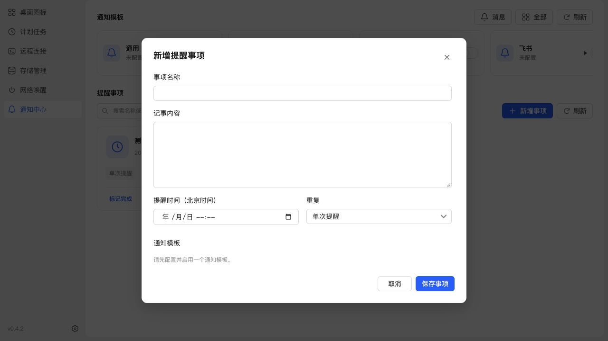
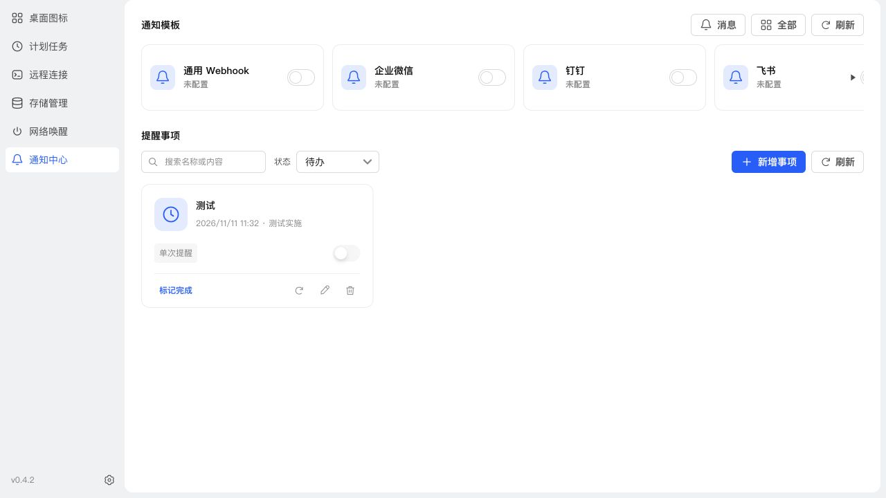

# 提醒必填校验与模板箭头

日期：2026-11-10

提醒事项保存必须填写时间，并选择至少一个已启用且配置完整的通知模板，暂停状态也不例外。DTO 拒绝缺失时间和空模板数组；存储层核对所属用户、模板启用和配置完整性。摘要增加 ready 字段供界面筛选，不返回令牌。无可用模板时保存按钮禁用，提示先配置；移除可无时间保存记事的说明。

模板两侧三角恢复透明背景，悬浮和按下沿用公共按钮状态；不增加占位轨道。

## 验证

- 新增/调整回归测试先失败后通过：无时间、空模板、停用模板在暂停提醒时也被拒绝；接口保留跨用户隔离校验。
- 全量 1009 项测试通过；构建、类型检查、ESLint、diff 检查通过。
- NAS 浏览器确认提醒时间 required=true，无模板时保存按钮 disabled=true；箭头常态背景 rgba(0,0,0,0)。验证未写入测试数据。
- SSH 备份、停止、替换运行文件、启动更新；保留数据。运行版本 0.4.2，应用中心登记信息未变。
- 数据库备份 `/tmp/notification-center-pre-1794281736807.sqlite`；更新后 schema 33，完整性 ok，外键错误 0，原模板与投递记录核对通过，现有提醒 1 条；关键接口 HTTP 200。

