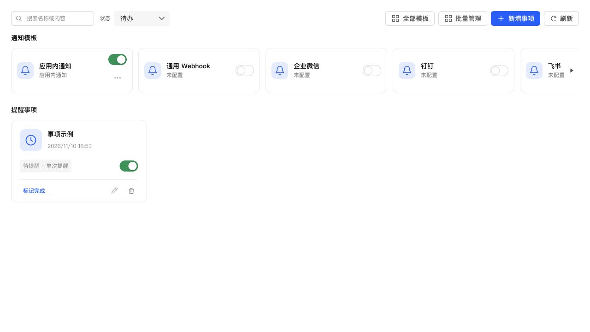
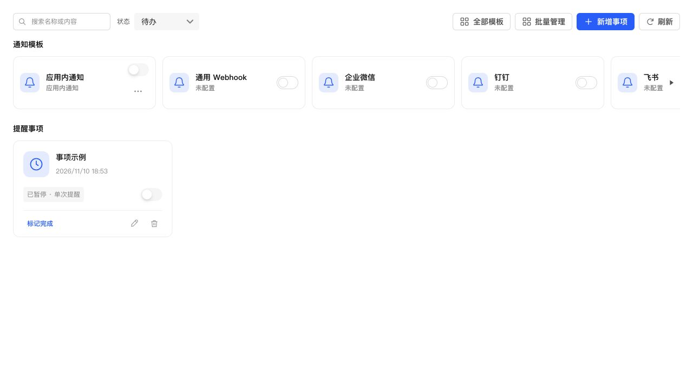

# 提醒模板关联恢复与公共开关核对

## 修复

暂停提醒允许删除关联模板，旧逻辑重新启用时逐个校验原模板 ID，导致剩余模板可用时仍被已删除 ID 阻断。现在恢复时只从当前账号的已保存关联中移除已删除模板，再沿用原校验与事务更新。普通新增、编辑仍严格拒绝未知或其他账号的模板 ID。

存在但已停用的关联继续保留；至少需要一个已启用且配置完整的模板才能恢复。全部关联已删除时明确提示重新选择模板，失败不会改动原暂停事项。

模板和事项本来就共用 `web/ui/switch-control.tsx`，本次未添加独立开关样式。浏览器实测相同状态下均为 40×24px，开启状态背景和边框一致。关闭状态也使用同一组件；需排除悬浮过渡造成的瞬时色差。未配置模板维持 Semi 的禁用外观，并补充“请先配置通知模板”提示；已配置模板补充启用、停用及渠道不可用提示。

## 验证

- 修复前，部分模板删除后的恢复、全部删除后的错误提示两项测试失败；修复后通过。
- 提醒测试 14 项通过，覆盖恢复、实际到期入队、全部删除后保持原数据、保留已停用关联、普通编辑的账号隔离。
- 通知界面测试 33 项通过，补充公共开关的受控状态与禁用说明。
- 全量 1041 项测试通过；TypeScript、前端契约审计、生产构建和 ESLint 通过。
- 使用实际通知页面组件和生产 CSS 的本地浏览器页面，对比模板、事项开关并操作开关；开启状态实测均为 40×24px、背景 `rgb(0, 158, 97)`，边框均为透明 1px。该颜色来自本地测试页主题，不作为 NAS 当前强调色的断言。
- 完整生产页面能渲染导航与错误反馈，不出现初始化白屏。本地静态页面没有 NAS 业务 API，不将该检查表述为 NAS 登录业务验收；未做手机真机测试。

## NAS 更新

按既有 SSH 停止、备份、替换、启动流程保留数据更新，运行版本仍为 0.4.2，应用中心登记版本未改。

- 数据库备份：`/tmp/notification-center-pre-1794304421604.sqlite`。
- 运行文件备份：`/tmp/adb-runtime-backup.3ax78Y`。
- 数据库版本仍为 34，完整性正常、外键错误 0；原配置数量一致，模板和投递记录校验通过，原有 1 条提醒保留，版本和关键业务接口正常。
- 生产资源完整，React 核心未反向导入 ui-vendor。本地与 NAS HTML SHA256 均为 `b1744c69aad3fc3c24919524bb04d466be620dca5d4fe5c71854d45be0d1dc33`。
