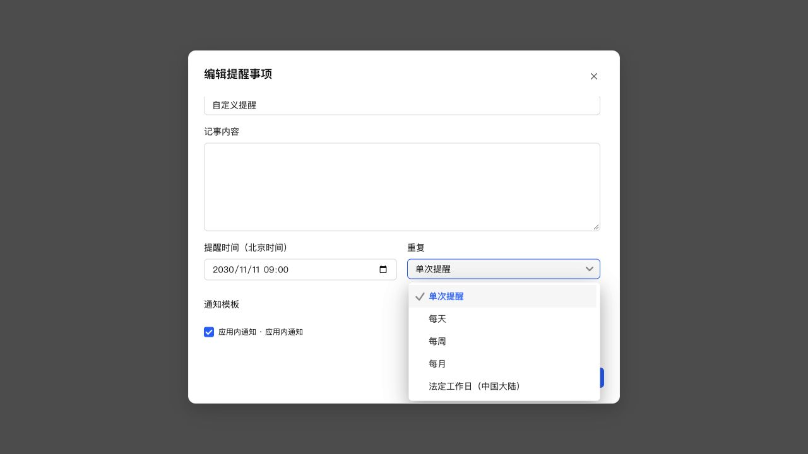

# 下拉菜单保持向下展开

按用户补充要求移除自动向上翻转逻辑。公共选择组件默认始终向下展开，按弹窗下方剩余空间限制菜单与内部选项区高度，超出部分滚动查看，保留显式指定的方向。

浏览器验证弹层向下展开，高度约 189.5px，位于弹窗可见范围内，内部可滚动，末尾“自定义”可选择。使用真实组件、生产 CSS 和模拟数据。

49 项相关测试、类型检查、生产构建、相关 ESLint 和 diff 检查通过。已保留数据通过 SSH 更新 NAS，运行版本仍为 0.4.2，应用中心登记版本不变。数据库 36、完整性 ok、外键错误 0，原模板和投递数据一致，原提醒仍为 1 条，关键接口正常。

- 数据库备份：`/tmp/notification-center-pre-1794325027067.sqlite`
- 运行备份：`/tmp/adb-runtime-backup.3aDNGR`
