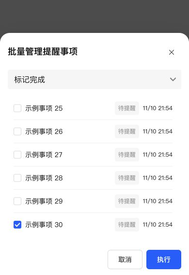
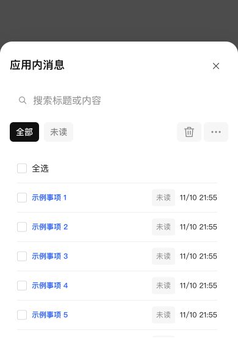

# 提醒批量管理与应用消息复用存储列表管理布局

提醒事项批量管理、应用消息使用存储管理“批量管理空间分析记录”的公共 list-management-dialog、dialog-scroll-surface 容器及相同 large/workspace 尺寸。公共列表容器在包含记录列表时锁住外层滚动，由列表自身滚动，标题、工具栏和底部操作保持固定。共用既有紧凑列表与公共表单留白，未新增页面专用 CSS。

消息详情与列表保持相同容器类名，避免 React 重绘 className 时移除移动端适配标记；详情没有记录列表时允许正文区域滚动。

## 验证

- 回归测试先复现两处未使用公共列表管理容器；修改后通知 UI 与投递记录 UI 39 项测试通过。
- 增加消息列表/详情往返时容器类名不变的断言。修改文件 ESLint、类型检查、生产构建及 diff 检查通过。
- 使用真实组件、生产样式和 30 条本地模拟记录，在浏览器 390×568 短屏操作验证：批量管理选择第 30 条后底部操作仍可见，footer bottom=568；两处 body overflow=hidden 且自身不溢出，列表可滚动。
- 消息详情正文 overflow=auto；返回列表后 overflow=hidden，移动端标记保留，面板宽度 390px。未发送外部通知，未进行手机真机操作。

## NAS 部署

通过 SSH 停止、备份、替换、启动，保留数据，未使用应用中心安装/卸载。运行版本仍为 0.4.2，应用中心登记版本不变。

- 数据库备份：`/tmp/notification-center-pre-1794318853615.sqlite`
- 运行备份：`/tmp/adb-runtime-backup.kpPR9N`
- 关键接口正常，生产引用资源完整；数据库版本 34，完整性 ok，外键错误 0。
- 原模板及投递记录完整记录校验一致，提醒仍为 1 条，既有配置数量保留。
