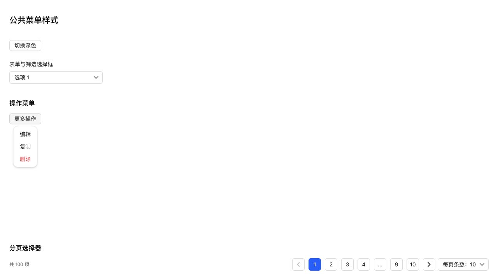
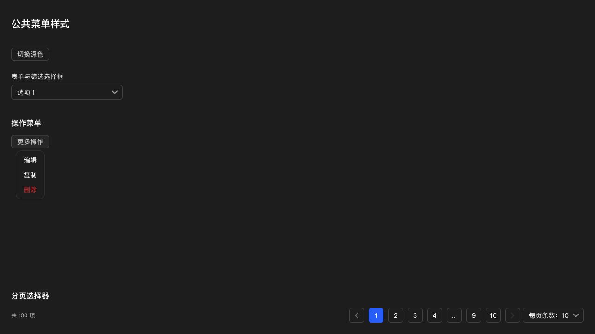
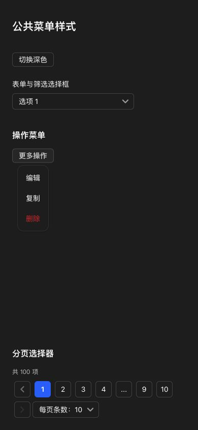

# 公共菜单面板与轻阴影

## 调整

选择框、分页内置选择器、Semi Dropdown 操作菜单和右键菜单共用 `web/styles/shared-menus.css`。保留 Select 与 Dropdown 各自交互，不替换框架分页实现。

- 公共面板圆角沿用应用内容圆角（默认 12px），细边界使用主题线色，阴影统一为 Semi shadow-2，替代原 10～40px 大范围投影。
- 阴影仅由外层面板绘制，移除选择框内部重复投影。
- 菜单项统一 14px 字号、20px 行高、6px 12px 内边距；桌面最小高度 32px，移动端 40px。
- 所有选项列表共用限高滚动规则；普通选择框继续向下展开并按剩余空间限高，分页保留顶部展开。
- 分页选择框触发器并入公共选择框样式，移除其独立字号、颜色和焦点规则。
- 移除未引用的旧容器下拉搜索样式、旧容器选择器专用规则及重复菜单面板样式。

## 验证

65 项相关测试、类型检查、生产构建、全项目 ESLint、修改文件格式与 diff 检查通过。浏览器测试页使用真实 NativeSelect、Dropdown、TaskPagination 和与生产 HTML 完全相同的 CSS 加载顺序。

实际计算样式确认三类面板圆角、阴影、14px 字号和 6px 12px 间距一致；选择框内部阴影为 none。分页切换到每页 20 条正常；深色细边界为 rgba(255,255,255,0.08)，小屏幕菜单项实际高度 40px，390px 页面无横向溢出。未使用手机真机。

## NAS 更新

通过 SSH 停止、备份、替换运行文件、启动，保留应用数据，未使用应用中心安装或卸载。运行版本仍为 0.4.2，应用中心登记版本未变。数据库版本 36，完整性 ok，外键错误 0，原模板及投递数据一致，提醒仍为 1 条。关键接口与生产资源正常。

- 数据库备份：`/tmp/notification-center-pre-1794325586281.sqlite`
- 运行文件备份：`/tmp/adb-runtime-backup.6wprEw`
