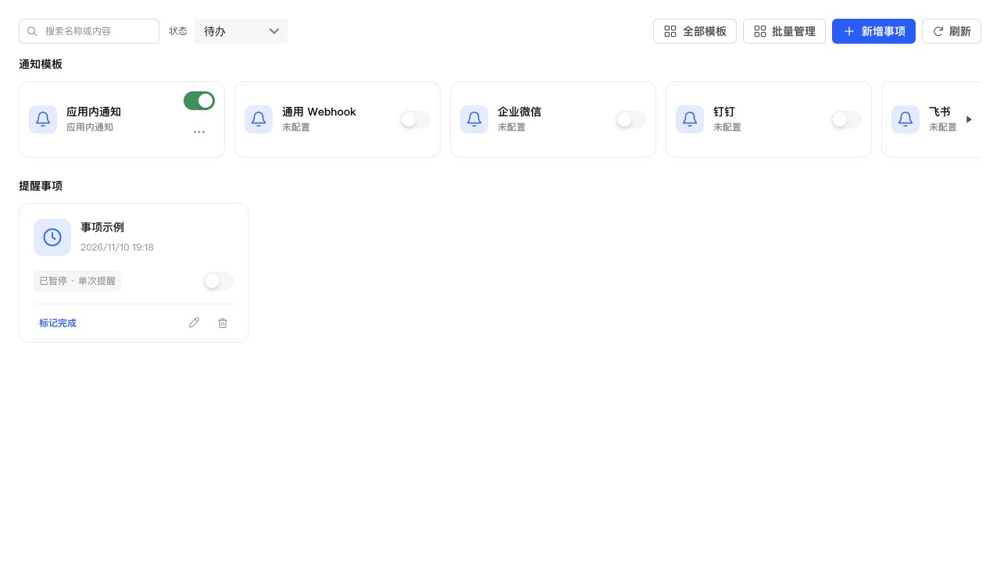

# 关闭状态开关外观统一

用户截图指出：未配置模板的禁用开关为空心描边，事项的普通关闭开关为浅灰实底。前次仅比较相同启用状态，没有覆盖这项差异。

在公共 `switch-control` 样式中统一禁用关闭状态的底色、透明轨道边框，以及关闭滑块的边框和阴影。底色使用 Semi 的 `--semi-color-fill-0`，滑块阴影沿用 Semi 普通开关的原值；尺寸、开启状态、loading、禁用语义和提示不变，没有增加通知模板专属样式。

浏览器使用真实通知页面组件与生产 CSS，对比“未配置且禁用的模板”与“已暂停且可操作的事项”：均为 40×24px，底色均为 `rgba(14, 14, 15, 0.04)`、轨道边框透明、滑块无描边且阴影一致；前者仍为 disabled。测试页面使用本地示例数据，未操作 NAS 上的提醒或模板。

通知界面 33 项测试、全量类型检查与生产构建通过；本次仅修改公共 CSS，未重复运行后端测试。

已按 SSH 停止、备份、替换、启动流程保留数据更新 NAS。运行版本仍为 0.4.2，应用中心登记版本未改。关键接口正常；原配置数量、模板和投递记录校验通过，原有 1 条提醒保留，数据库版本 34、完整性正常、外键错误 0。

数据库备份 `/tmp/notification-center-pre-1794305926497.sqlite`，运行文件备份 `/tmp/adb-runtime-backup.qCEoxP`。
