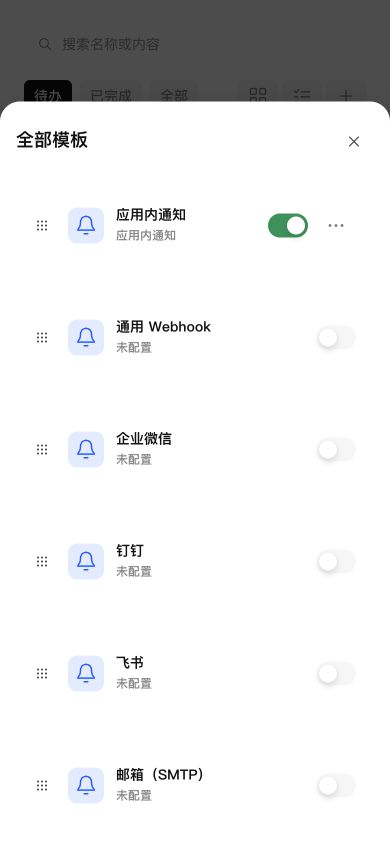

# 通知模板开关与更多操作对齐

公共 CompactCard 的控件区域原为纵向 flex 布局，开关和更多按钮上下排列。改为默认横向排列，固定控件区不收缩，使用既有 8px 间距和垂直居中；保留原卡片尺寸、公共开关及更多按钮。横向模板栏、全部模板桌面网格及移动端均使用同一公共规则，无页面专用覆盖。

## 验证

- 37 项通知 UI 测试通过；类型检查、生产构建及 CSS 格式检查通过。
- 浏览器操作检查横向模板栏和全部模板，390×844 窄屏确认开关与更多按钮同一中心线、间隔 8px，无重叠。使用真实组件和生产样式、本地模拟数据，未发送外部通知。

## NAS 更新

SSH 停止、备份、替换运行文件、启动流程保留现有数据。运行版本仍为 0.4.2；未修改应用中心登记信息。

- 数据库备份：`/tmp/notification-center-pre-1794318602807.sqlite`
- 运行备份：`/tmp/adb-runtime-backup.7iDSHB`
- 服务及关键接口正常，生产资源完整，数据库版本 34，完整性 ok，外键错误 0。
- 模板及投递记录校验一致，提醒仍为 1 条；现有配置数量保持不变。
