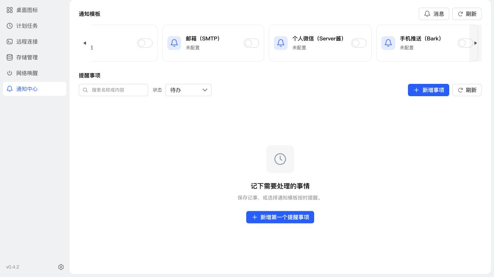

# 通知模板边缘遮罩验证

日期：2026-11-10

模板行移除左右独立占位轨道，三角恢复为边缘覆盖按钮，使用不透明主题背景遮罩。到达滚动边界后隐藏对应按钮，不留下空白。遮罩避开底部滚动条，保留公共滚动条的渐隐行为和滚轮横向滚动。

## 验证

- 相关 UI 与滚动条测试 16 项通过；构建、类型检查、ESLint、`git diff --check` 通过。
- 桌面模板行与容器宽度均为 1044px，起始边缘无额外占位；遮罩背景不透明（opacity 1）。左右按钮随滚动位置显示。
- 375px 小屏幕模板行与容器宽度均为 343px，页面宽度 375px，无页面横向溢出。
- 已通过 SSH 停止服务、替换运行文件、启动方式更新 NAS，运行版本 0.4.2，应用中心登记元信息未变；本次不生成安装包。
- 更新前数据库备份：`/tmp/notification-center-pre-1794279142788.sqlite`。
- 更新后数据库 schema 33，完整性检查 ok，外键错误 0；原模板、投递记录及业务配置数据核对通过。
- 通知、SSH、VNC、RDP、ADB 关键接口返回 HTTP 200。

## 截图

