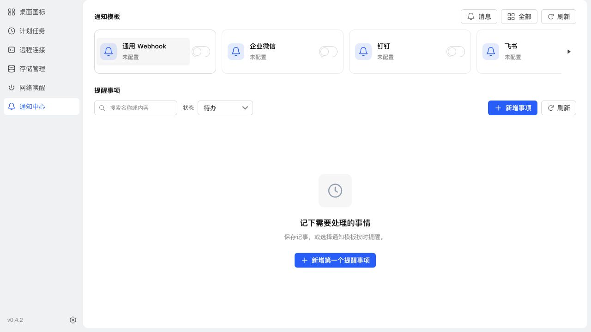

# 模板卡片悬浮留白

日期：2026-11-10

公共 CompactCard 的图标文字按钮原先 padding 为 0，悬浮背景左侧紧贴图标。调整为四周 8px 内边距，以负外边距抵消尺寸变化，保持原内容和右侧控件位置。横向模板行及全部模板网格使用同一公共样式。

## 验证

- 23 项通知 UI、共享样式回归测试通过；生产构建、类型检查、Prettier 和 diff 检查通过。
- NAS 浏览器悬浮截图确认四周留白；修改前后首张卡片图标坐标均为 x217、y94，尺寸均为 36×36；全部模板八张卡片的按钮 padding 均为 8px。
- SSH 备份后停止、替换运行文件、启动，保留全部应用数据；运行版本 0.4.2，应用中心登记信息未修改。
- 更新前数据库备份：`/tmp/notification-center-pre-1794280555672.sqlite`。
- 更新后 schema 33，完整性 ok，外键错误 0，原模板、投递记录和业务配置核对通过；关键接口 HTTP 200。

