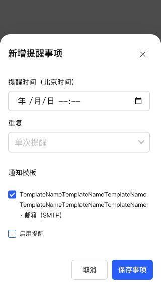

# 内置模板编辑与通知中心移动端复查

所有内置渠道配置弹窗统一为“编辑通知模板”，移除“启用通知”勾选项及其旧布局容器。保存新配置或已有暂停模板时提交 enabled=true；停用仍通过卡片开关完成。首次保存仍使用现有 POST、后续编辑使用 PUT，不改变渠道数据模型及验证规则。已移除渠道仍无法保存。

## 小屏幕复查与修复

在 320×568 浏览器视口检查全部八种内置渠道的配置表单：无横向溢出，底部按钮可见，长表单可以独立滚动。未发送外部通知或修改真实模板。

发现并修复两处长名称遗漏，均使用公共规则：

- 提醒事项的模板勾选项：连续英文长名称使表单 scrollWidth 从 314 增至 544px。form-check-row 公共标签限制最大宽度并允许按需换行后，scrollWidth 恢复为 314px。
- 应用消息详情长标题：正文宽 320px 时 scrollWidth 达 599px。record-content 公共标题允许按需换行后，scrollWidth 恢复为 320px。

## 验证与部署

- 回归测试先复现旧标题；修复后通知 UI 与投递记录 UI 41 项测试通过，覆盖首次保存启用、暂停模板编辑后启用、移除启用勾选项及卡片开关功能。
- 类型检查、生产构建、修改文件 ESLint、格式检查及 diff 检查通过。本轮浏览器视口验证，未操作手机真机。
- 使用 SSH 停止、备份、替换、启动更新 NAS，保留数据，未执行应用中心安装或卸载。运行版本仍为 0.4.2，应用中心登记版本不变。
- 数据库备份：`/tmp/notification-center-pre-1794319708631.sqlite`
- 运行文件备份：`/tmp/adb-runtime-backup.E3epq4`
- 关键接口正常，生产资源完整，数据库版本 34，完整性 ok，外键错误 0。
- 既有模板和投递数据完整记录校验一致，原提醒仍为 1 条；更新本身不批量启用旧模板，仅用户保存模板时启用。
