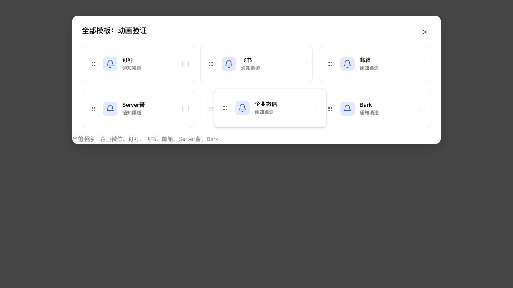

# 全部模板拖拽动画验收

将公共 SortableCards 的手写指针逻辑替换为 dnd-kit React 0.5.3，原实现已删除。继续使用公共 CompactCard、图标按钮及左侧九点把手；服务端保存接口和账号隔离规则不变。

拖动卡片跟随指针，淡色占位保留目标空间，其他卡片平滑让位；松手后约 220ms 落位并保存。浮层复用公共阴影变量，挂载到所属 dialog，避免被原生模态层遮挡。库内置处理 prefers-reduced-motion。鼠标移动 5px 启动，触摸长按 250ms；键盘为空格开始、方向键移动、回车确认、Esc 取消，把手提示及使用文档已同步。

## 验证

- 1031 项全量测试通过；TypeScript、前端契约审计、生产构建和 ESLint 通过。
- 通知界面 27 项测试通过。JSDOM 测试通过外部库边界传入完成事件，验证保存、取消、无目标放置、失败恢复以及顶部顺序同步；校验长按、键盘传感器和动画配置。JSDOM 不具备真实布局与 Web Animations，此处没有将其作为真实手势验收。
- 本地浏览器挂载实际公共弹窗、排序组件、卡片及生产 CSS，实测鼠标跟随、让位、放置保存；浮层能显示在模态遮罩上方，浮层不透明，保留淡色占位。键盘确认与 Esc 取消均已操作验证；模拟减少动态效果偏好时仍能正常排序。
- 手机长按沿用库的触摸传感器配置，未进行手机真机验收。本次浏览器验证使用本地组件页面，没有声称通过 NAS 登录界面的手势验收。

## NAS 更新

已按既有 SSH 停止、备份、替换、启动流程保留数据更新，未使用应用中心安装路径。运行版本仍为 0.4.2，应用中心登记版本未改。

- 数据库备份：`/tmp/notification-center-pre-1794300557226.sqlite`。
- 运行文件备份：`/tmp/adb-runtime-backup.XtF1Bz`。
- 数据库版本仍为 34，完整性正常，外键错误 0。
- 原业务配置数量保持一致，原模板及投递记录校验通过，原有 1 条提醒保留；版本及关键业务接口正常。

官方参考：[React 排序 API](https://dndkit.com/react/hooks/use-sortable/)、[排序状态与取消处理](https://dndkit.com/react/guides/sortable-state-management/)、[传感器与把手](https://dndkit.com/react/guides/sensors/)。
