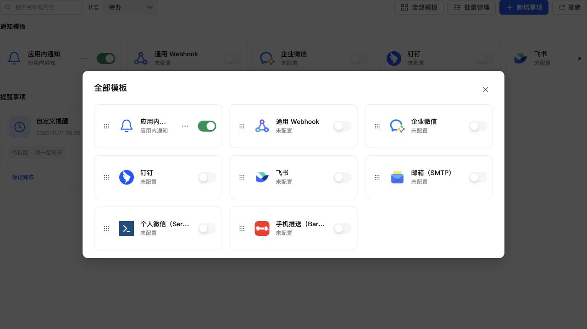

# 通用 Webhook 节点图标

将彩色链接图标替换为三节点连接图标，复用公共 SVG 图标系统，保持 32px 和透明底色，删除原彩色链接图标定义。

45 项通知 UI 测试、生产构建（含类型检查）、相关 ESLint 和 diff 检查通过。浏览器以真实组件、生产 CSS 与模拟数据确认显示效果。

通过 SSH 停止、备份、替换运行文件、启动更新 NAS，保留数据。运行版本 0.4.2，应用中心登记版本未变。关键接口、生产资源正常，数据库版本 35，完整性 ok、外键错误 0，原模板与投递数据一致，提醒 1 条。

- 数据库备份：`/tmp/notification-center-pre-1794323338216.sqlite`
- 运行文件备份：`/tmp/adb-runtime-backup.FASzLI`
