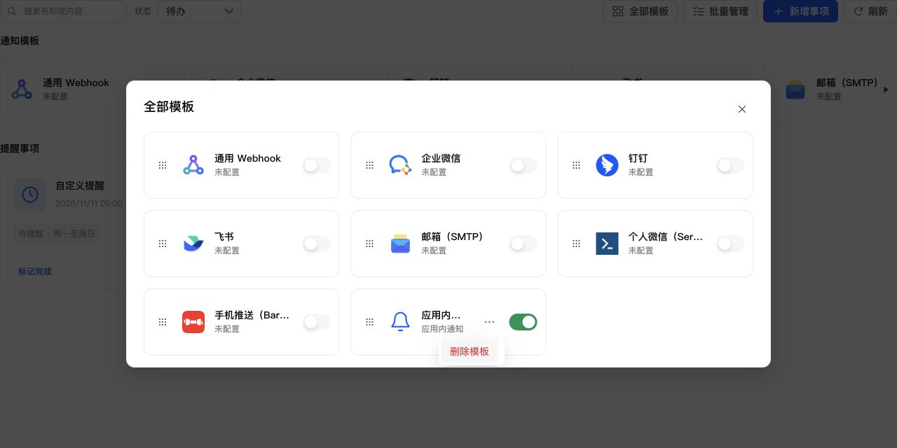

# 操作菜单在弹窗内限高

## 问题与处理

全部模板最下排的“更多操作”菜单原本只受窗口最大高度限制，未扣除 dialog 底部剩余空间，导致后续操作被裁切。模板菜单与应用消息弹窗的操作菜单改用公共 BoundedDropdown；与 NativeSelect 共用 useBoundedPopup，保留向下展开，空间不足时菜单内部滚动。

沿用现有公共菜单的圆角、阴影、行高与滚动条，没有新增页面独立样式。窗口、可见视口、容器尺寸或滚动位置变化时重新限高；锚点被遮挡或剩余空间不足时收起。普通侧边菜单和右键菜单保持原交互。

## 验证

- 新增三项操作菜单回归测试，覆盖 dialog 限高、保持方向、打开后重算及受控菜单遮挡收起；原选择框五项定位测试仍通过。
- 全项目 1084 项测试、类型检查、生产构建、ESLint、修改文件格式及 diff 检查通过；独立只读审查未发现明确缺陷。
- 使用真实 React/Semi 组件、生产 CSS 和模拟数据在浏览器验证，窗口 1280×640：底排菜单底部 522px，小于 dialog 底部 525px，菜单可见高度 37px、内容高度 136px，滚动可见最后的“删除模板”，点击“应用消息”正常打开消息弹窗。
- 消息操作菜单底部 270px，位于所属弹窗底部 560px 内。临时验证页面不调用真实通知渠道。

## NAS 更新

已通过 SSH 停止、备份、替换运行文件、启动，保留当前应用数据，未使用应用中心安装或卸载。运行版本仍为 0.4.2，应用中心登记版本未变。服务、关键接口及生产资源正常，数据库 36、完整性 ok、外键错误 0；原模板与投递数据一致，提醒仍为 1 条。

- 数据库备份：`/tmp/notification-center-pre-1794364232581.sqlite`
- 运行文件备份：`/tmp/adb-runtime-backup.btJjWr`
