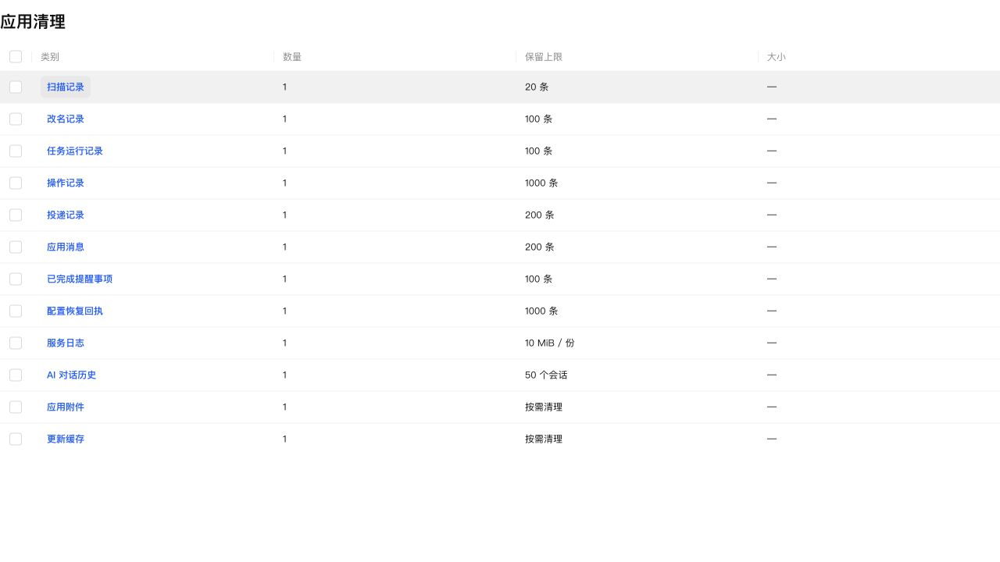

# 应用清理类别按钮悬浮留白

类别按钮使用公共 text-button，但原 padding 为 0，公共按钮的悬浮底色会紧贴文字。公共文字按钮内边距统一为上下 4px、左右 8px，并移除历史记录表中旧的零内边距覆盖，不新增应用清理专属样式。

共享样式及应用清理 16 项测试、类型检查、生产构建、修改文件格式和 diff 检查通过。真实组件与生产 CSS 的浏览器检查：桌面按钮 padding=4px 8px、高 28px；390px 移动端同样保留内边距，扫描记录按钮宽 64px、所在行高 48px，没有挤压。

## NAS 更新

已通过 SSH 停止、备份、替换运行文件、启动，保留数据。运行版本仍为 0.4.2，应用中心登记版本未变。服务、关键接口和资源校验正常；数据库 36、完整性 ok、外键错误 0，原模板和投递数据一致，提醒仍为 1 条。

- 数据库备份：`/tmp/notification-center-pre-1794376545450.sqlite`
- 运行文件备份：`/tmp/adb-runtime-backup.d88XMu`
