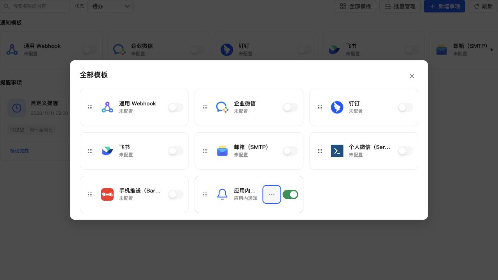

# 操作菜单 Esc 关闭顺序

## 修复

“全部模板”弹窗展开更多操作后按 Esc，原菜单收起但浏览器继续触发原生 dialog 的 cancel，导致弹窗一起关闭。公共 BoundedDropdown 使用 Semi 的 onEscKeyDown 回调，仅在菜单展开时阻止浏览器默认关闭动作。

Semi 在菜单隐藏后仍拦截触发按钮的 Esc，因此菜单关闭时在触发按钮的捕获阶段停止该键传播，不阻止浏览器默认动作，使下一次 Esc 正常关闭弹窗。保留调用方的键盘回调和原按钮捕获回调，不新增样式。

## 验证

新增三项回归测试，分别覆盖展开时阻止 dialog 默认关闭、收起后不消费 Esc、隐藏触发按钮避开 Semi 拦截；均先复现失败，再修复通过。

真实 React/Semi 组件、生产 CSS 与模拟数据的浏览器验证：

- 第一次 Esc：菜单 aria-expanded=false，dialog 保持打开，焦点回到更多操作按钮。
- 第二次 Esc：dialog 数量变为 0，正常回到通知中心。

全项目 1087 项测试、类型检查、生产构建、ESLint、格式及 diff 检查通过。独立只读审查未发现需要修复的问题。

## 部署验收

已通过 SSH 停止、备份、替换运行文件、启动，保留应用数据，未执行应用中心安装或卸载。运行版本仍为 0.4.2，应用中心登记版本未变。服务与关键接口正常，生产资源校验通过；数据库 36、完整性 ok、外键错误 0，原模板与投递记录一致，提醒仍为 1 条。

- 数据库备份：`/tmp/notification-center-pre-1794364928860.sqlite`
- 运行文件备份：`/tmp/adb-runtime-backup.CPfagI`
