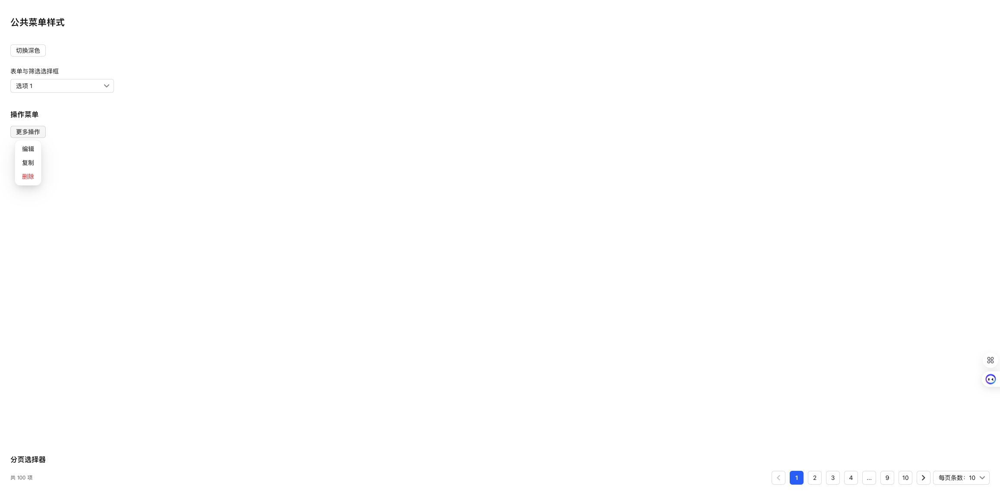

# 对齐飞牛原生菜单阴影

在用户已打开的飞牛系统设置 → 用户管理 → 更多菜单中，通过浏览器只读检查实际计算样式。菜单外层投影为：

```css
0 12px 42px -4px rgba(20, 23, 26, 0.12),
0 8px 18px -6px rgba(20, 23, 26, 0.2)
```

本应用主题已有对应的 `--semi-shadow-dropdown`。公共菜单阴影变量改为直接复用它，替代 shadow-2；选择框、操作菜单、右键菜单和分页菜单通过公共面板规则统一生效，内层继续不投影。用户提供的参考仅用于阴影，不更改菜单尺寸或交互。

Chrome 使用真实公共组件、生产 CSS 预览，并读取计算样式确认参数与飞牛原生菜单完全一致。未操作用户管理菜单中的停用、SSH 或密码功能。



16 项相关测试、类型检查、生产构建、格式及 diff 检查通过。通过 SSH 停止、备份、替换运行文件、启动更新 NAS，保留数据。运行版本仍为 0.4.2，应用中心登记版本不变。数据库版本 36，完整性 ok、外键错误 0，原模板及投递记录一致，提醒仍为 1 条。关键接口和生产资源正常。

- 数据库备份：`/tmp/notification-center-pre-1794356455835.sqlite`
- 运行文件备份：`/tmp/adb-runtime-backup.scJ2DL`
