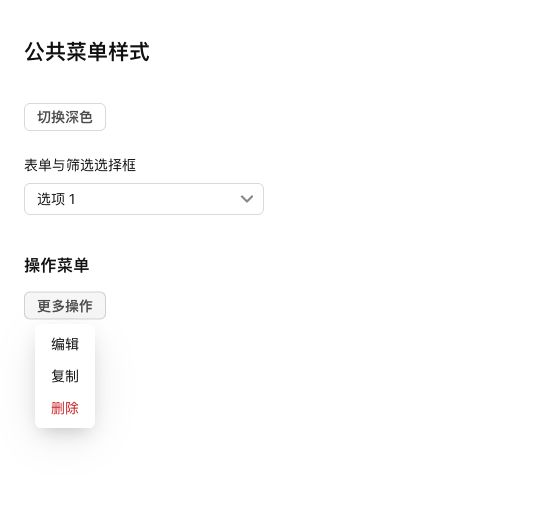

# 菜单面板对齐飞牛

按用户确认，将公共菜单面板圆角从 12px 改为 6px，移除 1px 边框，继续复用飞牛原生 `--semi-shadow-dropdown`。选择框、操作菜单、右键菜单和分页菜单共用该规则。页面卡片样式不变。

浏览器使用真实组件及生产 CSS 核对：圆角 6px、边框宽度 0px，阴影为 `0 12px 42px -4px rgba(20,23,26,.12), 0 8px 18px -6px rgba(20,23,26,.2)`，与先前实测飞牛原生菜单参数一致。预览截图保留菜单周围及控件上下文。

16 项相关测试、类型检查、生产构建、格式及 diff 检查通过。已通过 SSH 停止、备份、替换运行文件、启动更新 NAS，保留数据。运行版本仍为 0.4.2，应用中心登记版本不变。数据库 36、完整性 ok、外键错误 0，原模板和投递数据一致，原提醒仍为 1 条。关键接口及生产资源正常。

- 数据库备份：`/tmp/notification-center-pre-1794358099480.sqlite`
- 运行文件备份：`/tmp/adb-runtime-backup.vrwNnd`
