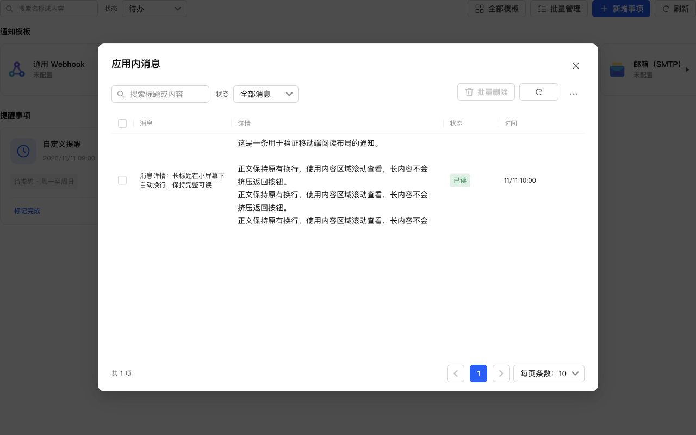
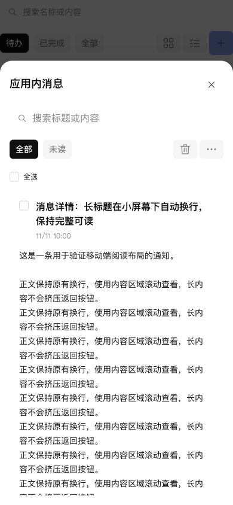

# 应用内消息直接展示正文

## 行为

- 桌面表格使用“多选框、消息、详情、状态、时间”顺序。详情列保留正文换行，长内容限制 160px 高并内部滚动，支持键盘聚焦阅读。
- 移动端使用公共 RecordCards 和已有 card/card-actions 样式，显示标题、时间、完整正文及状态，不再用压缩单行记录或打开详情页。
- 未读消息支持直接标为已读，保留批量标已读、批量删除、筛选与公共分页。只展示内容不自动清除未读，点击标已读时才提交；预览菜单点击消息仍标已读并打开名称筛选后的消息列表。
- 删除原 RecordDetail 组件、详情状态与返回导航，不保留两种展示方式。正文保持纯文本渲染，脚本字符只作为文字展示。

## 验证

通知测试修改前已复现失败，调整后 48 项通过。全项目 1090 项测试、类型检查、生产构建、ESLint、格式及 diff 检查通过；独立只读审查未发现明确缺陷。

使用真实 React/Semi 组件和生产 CSS 的浏览器验证：

- 1280×800：五列表头正确。详情可见高 160px、内容高 1166px，内容宽和滚动宽均为 360px；滚动到底 scrollTop=1006，无需另开详情。
- 390×844：没有桌面表格，卡片宽 352px，长标题、正文和连续链接正常换行，无横向溢出，正文不限制高度。
- 页面内只有应用内消息弹窗，消息名称不再是详情跳转按钮。

## NAS 更新

已通过 SSH 停止、备份、替换运行文件、启动，保留当前数据，未使用应用中心安装或卸载。运行版本仍为 0.4.2，应用中心登记版本未变。服务、关键接口及生产资源正常；数据库 36、完整性 ok、外键错误 0，原模板与投递记录一致，提醒仍为 1 条。

- 数据库备份：`/tmp/notification-center-pre-1794374516209.sqlite`
- 运行文件备份：`/tmp/adb-runtime-backup.z31JFi`
