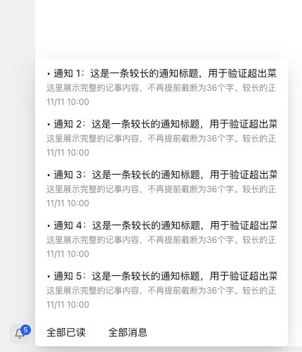

# 通知菜单底部操作同一行

“全部已读”和“全部消息”在菜单底部同一行显示，原“查看全部消息”改为“全部消息”。复用 Semi Dropdown 菜单项及公共 toolbar-actions 间距，没有增加页面专属 CSS。消息列表和底部操作使用平级菜单，避免嵌套无效列表。

通知中心 48 项回归测试、类型检查、生产构建、修改文件 ESLint、格式和 diff 检查通过。真实组件和生产 CSS 浏览器验证：两项 top 均为 556px、高均为 32px，水平间距 8px。

## NAS 更新

已通过 SSH 停止、备份、替换运行文件、启动，保留数据。运行版本仍为 0.4.2，应用中心登记版本未变。服务、关键接口及资源校验正常；数据库 36、完整性 ok、外键错误 0，原模板和投递记录一致，提醒仍为 1 条。

- 数据库备份：`/tmp/notification-center-pre-1794377088760.sqlite`
- 运行文件备份：`/tmp/adb-runtime-backup.72ZFdf`
