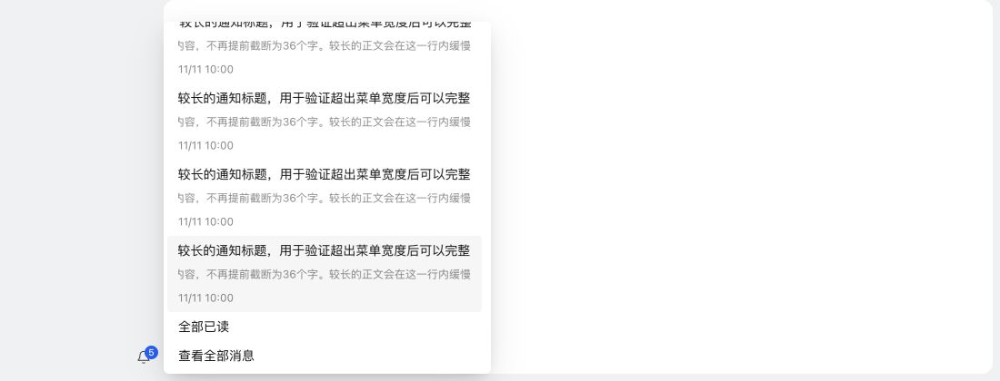

# 左下角通知菜单滚动显示

## 修复

- 预览标题与正文复用 AutoScrollName，超出宽度时在当前行自动往返滚动；取消原正文 36 字硬截断，悬浮标题仍保留完整原文，减少动态效果偏好下保留手动滚动。
- 将该组件原先只在小屏幕生效的几何样式提升为公共规则，不复制页面专属样式。
- 预览菜单沿用公共 content-surface-menu、菜单阴影和渐隐滚动条，宽度最多 360px，菜单项占满内容宽度，移除 Semi 默认 280px 菜单项限制带来的空白。
- 菜单使用 BoundedDropdown，侧向限高按底部对齐位置及偏移量计算；偏移后的边缘越界时收起，并在关闭后清除旧偏移，重新打开按当前布局对齐。
- 限高同步遵守公共外层的视口 32px 留白，避免外层与菜单各自滚动导致底部操作仍被裁切。

## 验证

新增三项侧向菜单测试，覆盖偏移限高、对齐边越界收起和视口留白约束；通知 UI 测试检查长内容未被截断并使用滚动组件。新增用例均先复现失败，修改后通过。针对性 62 项及全项目 1094 项测试通过；类型检查、生产构建、ESLint、格式与 diff 检查通过，独立复审未发现新的明确问题。

真实 React/Semi 组件、生产 CSS 和五条模拟消息的浏览器验证：

- 标题与正文超过可见宽度，实际 transform 持续变化，确认使用既有自动滚动。
- 1100×420：菜单范围 top=24、bottom=412，可见高 388px、内容高 492px；外层可见高与内容高均为 388px，无第二层溢出。
- 菜单滚动到底 scrollTop=104，“查看全部消息”底部 408px，在菜单底部 412px 内完整显示。
- 窗口变矮及重新打开后仍能显示完整底部操作。

## NAS 更新

已通过 SSH 停止、备份、替换运行文件、启动，保留当前数据，未使用应用中心安装或卸载。运行版本仍为 0.4.2，应用中心登记版本未变。服务、关键接口及生产资源正常；数据库 36、完整性 ok、外键错误 0，原模板与投递记录一致，提醒仍为 1 条。

- 数据库备份：`/tmp/notification-center-pre-1794375763601.sqlite`
- 运行文件备份：`/tmp/adb-runtime-backup.guvZgG`
