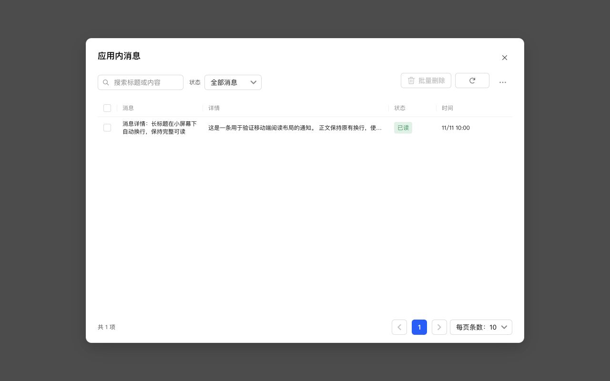

# 消息详情只显示记事内容并单行省略

提醒类应用消息从已保存投递 payload.content 读取原始记事内容，不再展示格式化通知文案中的标题、时间等附加内容。空记事内容保持为空，其他通知类型仍显示其消息文案。搜索与展示使用同一 SQL 表达式，不修改历史数据或数据库结构。

桌面详情列改用公共 record-preview：单行、超出省略，title 保留完整原文供鼠标悬浮查看，不再使用限高滚动框。移动端卡片继续直接阅读正文。

## 验证

新增后台回归覆盖自定义通知格式、空内容和搜索一致性；UI 测试校验悬浮全文与旧滚动框移除，修改前已复现失败。针对性 53 项测试及全项目 1091 项测试通过；类型检查、生产构建、ESLint、格式及 diff 检查通过，独立只读审查未发现明确问题。

1280×800 浏览器使用真实组件和生产 CSS：详情 white-space=nowrap、text-overflow=ellipsis，单行高度 17px，列宽 366px，title 与完整正文一致。

## NAS 更新

已通过 SSH 停止、备份、替换运行文件、启动，保留数据，未使用应用中心安装或卸载。运行版本仍为 0.4.2，应用中心登记版本未变。服务、关键接口及资源校验正常；数据库 36、完整性 ok、外键错误 0，原模板与投递记录一致，提醒仍为 1 条。

- 数据库备份：`/tmp/notification-center-pre-1794374993047.sqlite`
- 运行文件备份：`/tmp/adb-runtime-backup.YLyQC0`
