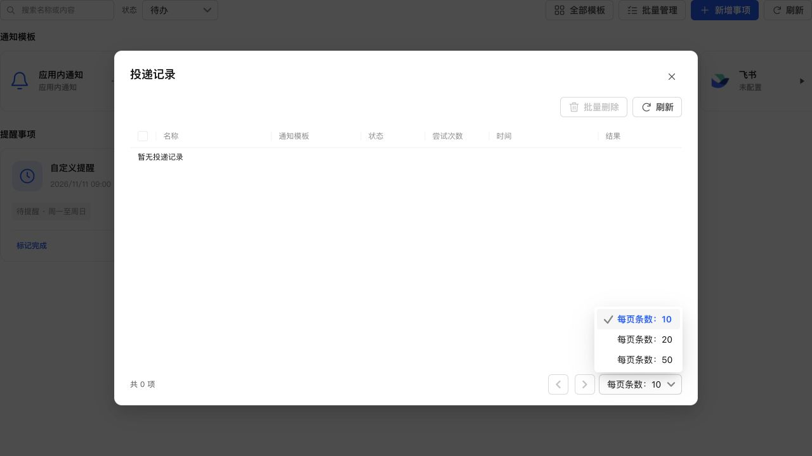
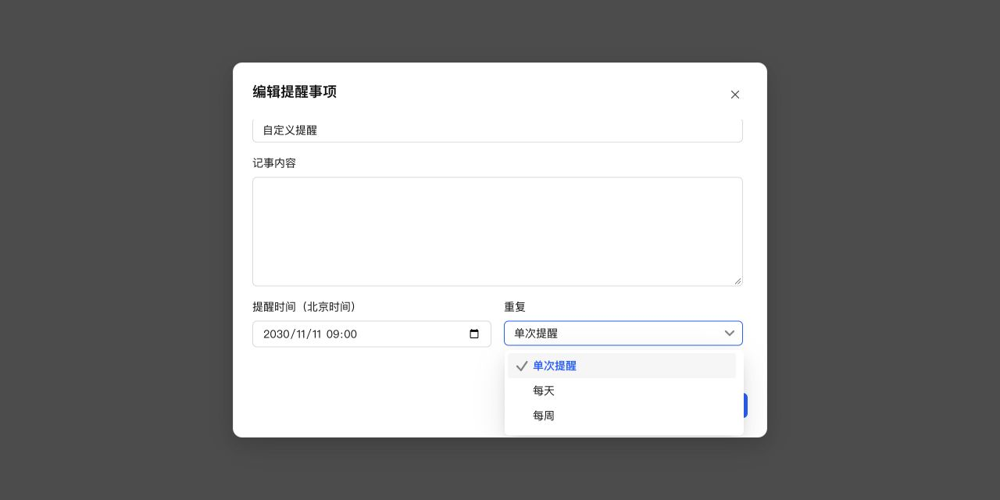

# 分页弹层层级与菜单动态限高

## 修复

- 公共 TaskPagination 使用 Semi ConfigProvider 指定弹层容器，原生弹窗中的每页条数菜单挂载到所属 dialog，普通页面仍挂载 body，全屏场景使用全屏容器。
- NativeSelect 与分页复用 popup-container 辅助函数，不增加独立样式或替换框架分页实现。
- 选择框展开时监听窗口 resize、捕获 scroll、visualViewport resize/scroll，以及触发器和容器的 ResizeObserver。窗口、滚动或可见区域变化后重新限高，仍保持向下展开。
- 锚点被表单滚动区遮住，或可用空间不足时，使用 Semi 的公开 close 方法收起菜单，避免留下空白小层。关闭及卸载释放监听与观察器，同值状态不重复更新。

## 验证

新增测试先复现了分页挂载 body、resize 不更新、visualViewport 不更新和离屏菜单不关闭，修复后通过。全项目 1081 项测试、类型检查、生产构建、ESLint、修改文件格式及 diff 检查通过。独立只读代码审查未发现新的明确缺陷。

真实 React 组件、生产 CSS 和模拟数据的浏览器复测：

- 投递记录弹窗内分页菜单 closest dialog 为 true，命中检测位于选项列表，成功选择每页 20 条。
- 窗口 720px → 640px 高时，向下菜单高度缩为 109.5px，底部 557.5px 位于弹窗底部 560px 内。
- 继续缩到 520px、锚点被表单遮挡时，选择框 aria-expanded=false 自动收起。
- visualViewport 边界及关闭后释放监听由回归测试验证；未使用手机键盘真机验收。

## NAS 更新

已通过 SSH 停止、备份、替换运行文件、启动，保留应用数据，未使用应用中心安装或卸载。运行版本仍为 0.4.2，应用中心登记版本未变。数据库 36、完整性 ok、外键错误 0，原模板与投递数据一致，提醒仍为 1 条。服务、关键接口及生产资源正常。

- 数据库备份：`/tmp/notification-center-pre-1794363039305.sqlite`
- 运行文件备份：`/tmp/adb-runtime-backup.NOkas2`
