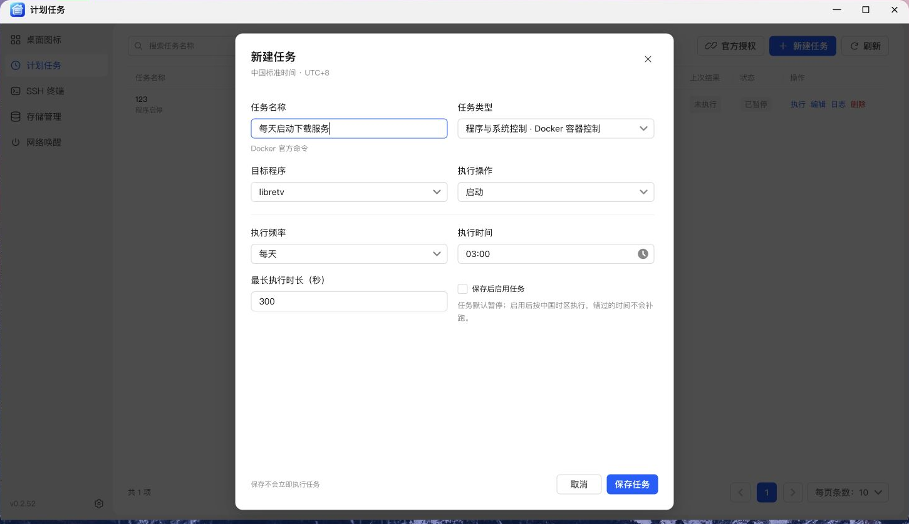
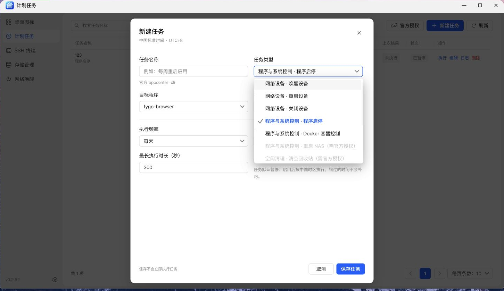
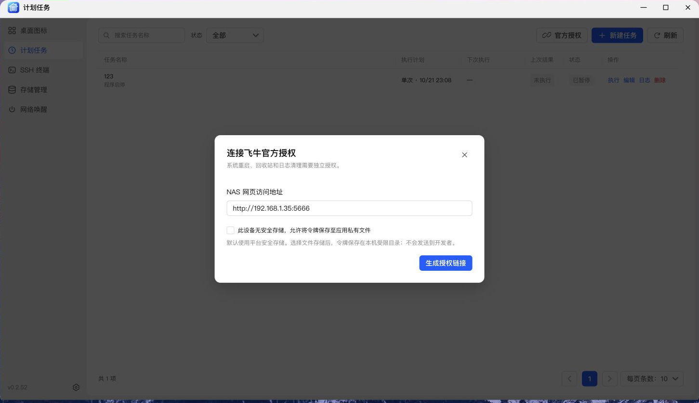

# NAS 管家——计划任务教程

> 适用版本：v0.2.52 · 配图来自 NAS 真机浏览器。表单示例仅作演示，请按自己的环境填写。

本篇介绍创建任务、官方授权、设备联动和执行记录。

---

## 能安排哪些任务？

| 任务                   | 主要用途                   | 使用条件                         |
| :--------------------- | :------------------------- | :------------------------------- |
| 程序启停               | 按计划启动、停止已安装程序 | 选择已安装的原生应用             |
| Docker 容器控制        | 启动、停止、重启指定容器   | 容器已部署                       |
| 重启 NAS               | 在指定时刻重启整台 NAS     | 需要飞牛官方授权                 |
| 清空回收站             | 清理当前授权账号的回收站   | 需要飞牛官方授权                 |
| 清理历史日志           | 按模块、级别清理日志       | 需要飞牛官方授权                 |
| 自定义脚本             | 执行自己编写的 Bash 脚本   | 检查脚本内容与执行时长           |
| 唤醒 / 重启 / 关闭设备 | 联动“网络唤醒”中的设备     | 先添加设备；电源控制还需关联 SSH |

当前不支持通用系统缓存清理、触发飞牛备份和创建快照。下拉框会区分不可用类型，以及尚未完成官方授权的类型。

## 第一个任务：每天启动一个容器

1. 打开 **计划任务**，点击 **新建任务**。
2. 填写任务名称，例如“每天启动下载服务”。
3. 任务类型选择 **Docker 容器控制**。
4. 选择目标容器与对应操作。
5. 执行频率选择 **每天**，填写执行时间。
6. 设置合理的最长执行时长。
7. 点击 **保存任务**，确认配置后启用。

新任务默认暂停，也可以主动勾选 **保存后启用任务**。保存不会立即替你执行一次；需要验证时，使用任务的 **执行** 操作。




截图展示的是未保存的表单草稿。容器名称、任务名称和执行时间请按实际用途填写。

## 时间怎么安排？

| 频率         | 适合的场景                       |
| :----------- | :------------------------------- |
| **每天**     | 固定时刻启动服务、执行日常维护   |
| **每周**     | 工作日唤醒设备、周末执行整理脚本 |
| **间隔分钟** | 按指定间隔执行检查               |
| **单次**     | 某一天的临时维护或一次性操作     |

计划按 **中国标准时间 UTC+8** 执行。启用后，可以在列表里查看下次执行时间。

> **提示：** NAS 或应用停止期间错过的时刻，不会在恢复后自动补跑。  
> 若是临时维护，请检查任务是否仍启用，以及下一次计划时间是否符合预期。

## 连接飞牛官方授权

重启 NAS、回收站清理、历史日志清理，需要单独完成授权。

1. 点击顶部 **官方授权**。
2. 填写当前使用的 **NAS 网页访问地址**，点击 **生成授权链接**。
3. 打开飞牛官方授权页，登录并确认需要的权限。
4. 将得到的一次性授权码填回本应用，完成连接。
5. 返回任务表单，选择现在可用的授权任务类型。

这里的授权与“你已经登录飞牛桌面”是两回事。未连接时，相关任务类型会有提示并禁止选择。设备若提示缺少平台安全存储，可按自己的选择允许使用弹窗说明的应用私有文件存储，再重试连接。





### 清理范围要看清

- **回收站：** 清理当前授权账号的全部回收站，不代表清理所有用户及团队空间。
- **历史日志：** 通过下拉选择日志级别、模块，不需要手填编号；当前不支持按“保留最近几天”清理。
- **重启 NAS：** 会中断 NAS 上正在提供的服务，请安排在合适的维护时间。

## 自定义脚本怎么开始？

第一次先用一个没有破坏性的脚本验证执行与日志：

```bash
#!/bin/bash
echo '计划任务执行成功'
date
```

填写脚本、设置频率与执行时长，保存后手动执行一次，再到日志里查看结果。

**原生应用中的脚本以 root 身份执行。** 因此，涉及文件删除、服务停机等操作时，先确认路径和影响范围，再启用周期执行。

## 联动网络设备

先在 **网络唤醒** 菜单添加设备；若需要重启或关机，再为设备关联已经配置好的远程 SSH 连接。

之后回到计划任务，选择 **唤醒设备 / 重启设备 / 关闭设备**，勾选目标设备，安排时间即可。

例如：每个工作日早上唤醒办公电脑。这里实际安排的是发送唤醒包，设备能否开机仍由网卡、电源设置及网络环境决定。

## 查看执行记录

点击任务操作列的 **日志**，在执行记录面板中查看：

- 执行时间、触发方式和结果；
- 耗时与退出码；
- 标准输出、错误输出。

列表支持分页，选择一条记录可以查看详情。任务失败时，先看错误输出，再检查授权、设备连接或脚本内容，避免反复盲目重试。

---

[← 返回项目首页](../README.md) · [下一篇：SSH 终端 →](ssh-terminal.md)  
开发者 / 发布者：[kaf](https://club.fnnas.com/home.php?mod=space&uid=91804)
