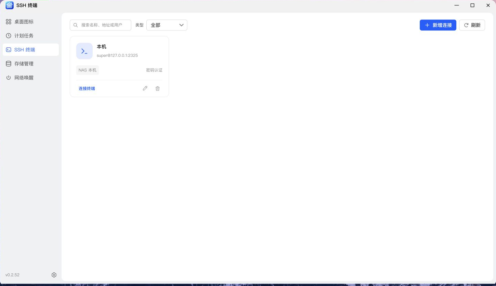
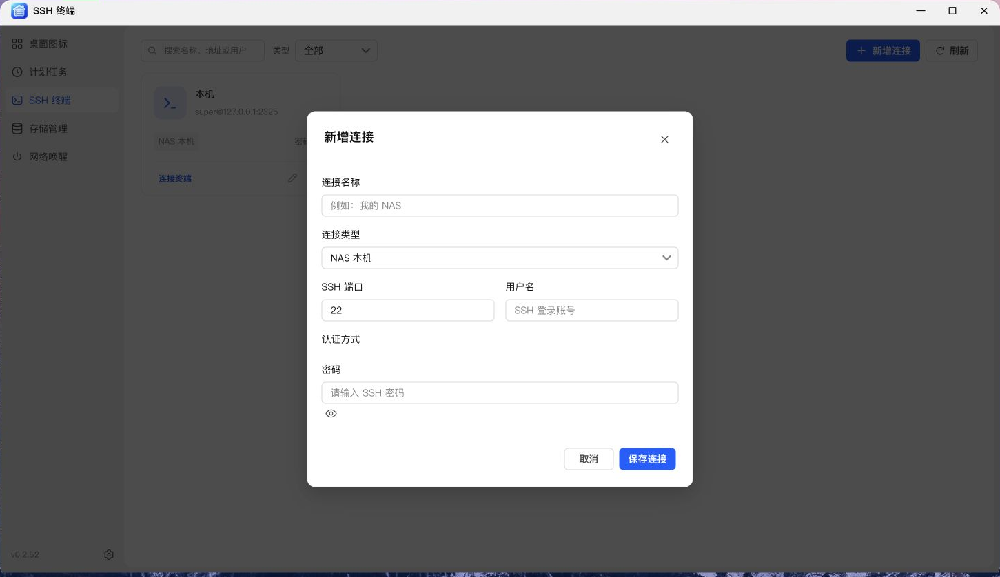
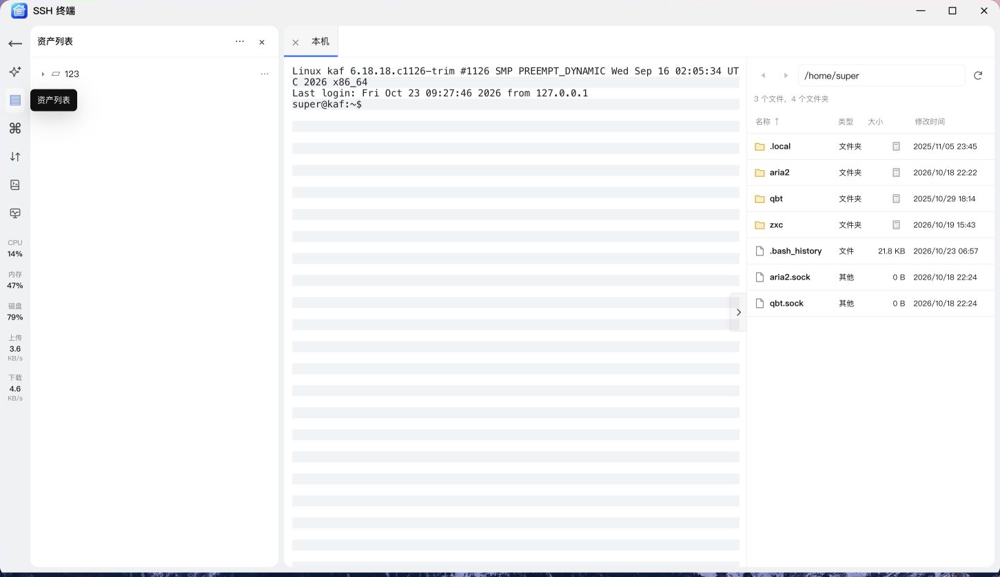
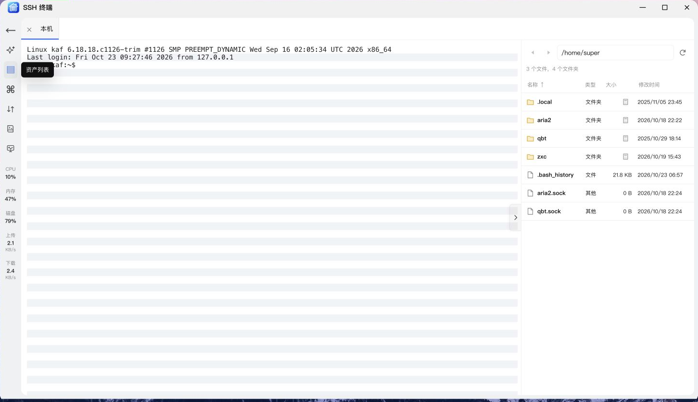
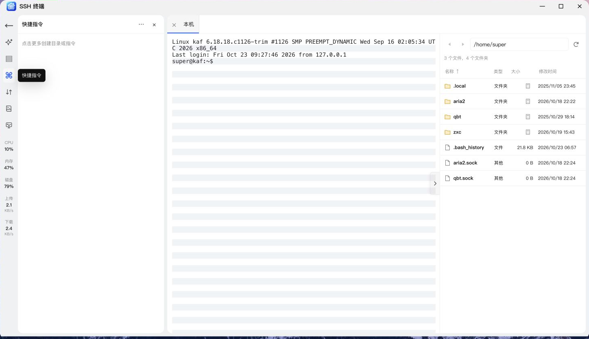
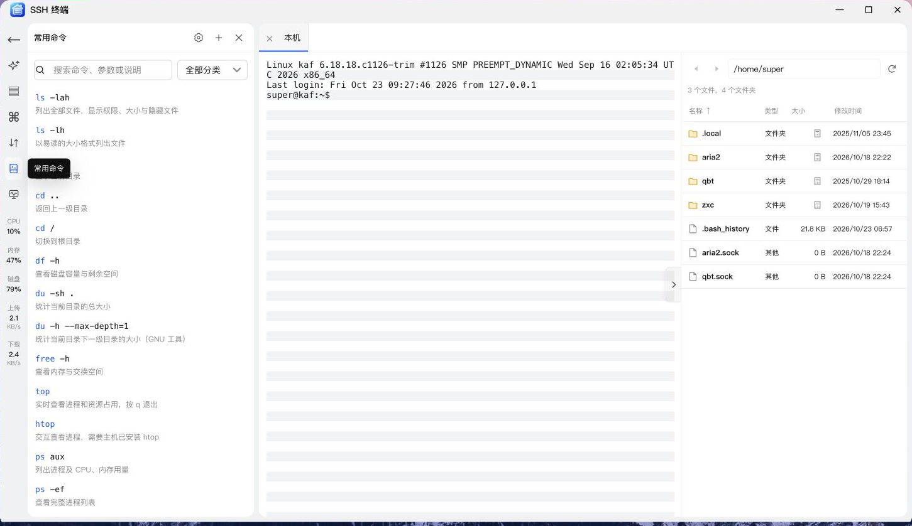
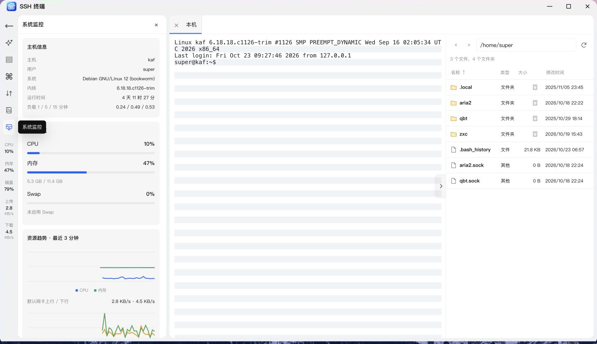
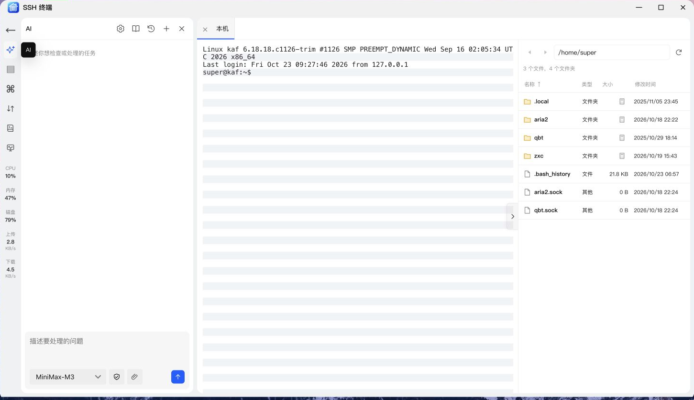
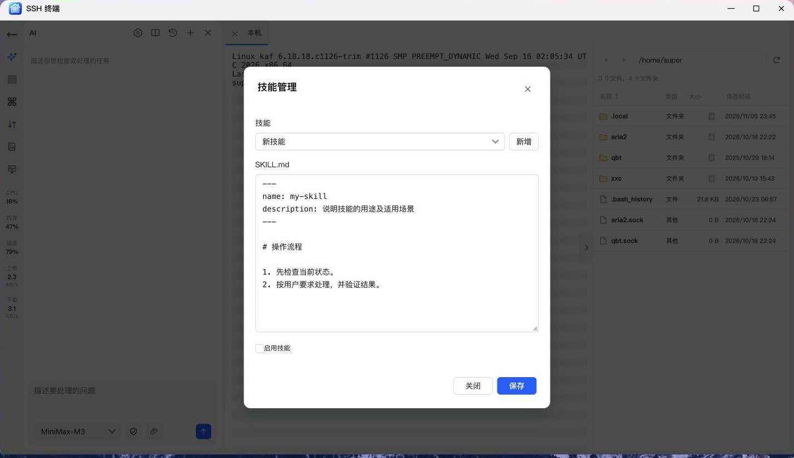

# NAS 管家——SSH 终端教程

> 适用版本：v0.2.52 · 配图来自 NAS 真机浏览器。表单示例仅作演示，请按自己的环境填写。

本篇从第一次连接开始，带你了解 SSH 终端的主要能力。

终端工作区将连接管理、文件操作、系统监控和智能助手集中展示，便于连续处理主机事务。

---

## 添加一个连接

打开 **SSH 终端 → 新增连接**，填写以下信息：

| 项目        | 怎么填写                           |
| :---------- | :--------------------------------- |
| 连接名称    | 自己容易识别的名称，例如“家庭 NAS” |
| 连接类型    | 本机或远程主机                     |
| 主机 / 端口 | 按目标主机实际 SSH 地址与端口填写  |
| 用户名      | 具有 SSH 登录权限的系统账号        |
| 认证方式    | 密码或私钥                         |

本机连接也要求 NAS 已启用 SSH；远程连接由 NAS 发起，因此目标主机需要能被 NAS 访问。

密码框右侧支持显示 / 隐藏。使用密钥时，可读取私钥文件；有私钥口令的，也需要填写相应口令。

保存后，点击卡片上的 **连接终端**，使用保存的认证信息登录。**仅打开主菜单不会自动连接。** 第一次连接遇到主机指纹确认时，先核对目标主机，再确认信任。

## 认识完整工作区

连接后会展开覆盖应用区域的终端工作区，主要分成三部分：

| 位置               | 内容                                                 |
| :----------------- | :--------------------------------------------------- |
| **左侧图标导航**   | AI、资产列表、快捷指令、文件传输、常用命令、系统监控 |
| **顶部连接标签**   | 切换不同主机，标签前的关闭按钮用于关闭该会话         |
| **右侧可展开区域** | 当前连接的文件管理面板                               |

终端采用浅色、灰白交替行的视觉形式。PC 上可以拖动分隔位置调整面板宽度；手机提供更适合小屏幕的布局与终端辅助按键。

## 多主机与资产分类

在资产列表里，可以使用目录组织连接，例如“家里”“办公室”“测试环境”。通过右键菜单或相应操作入口新建目录、新建终端，再按需要归类。

双击终端资产可打开连接标签；已经打开的连接会切回对应标签。切换标签不会把其他连接关闭。

编辑正在使用的连接时，应用会先询问是否断开并关闭连接，再进入编辑，避免配置和活动连接不一致。

## 文件管理：不用来回切换工具

点击终端右侧贴边、居中的展开按钮，打开文件面板。

- **双击文件夹：** 进入下一级目录。
- **路径栏：** 输入目标路径，使用前进、后退和刷新。
- **右键文件行：** 根据文件类型执行下载、重命名、删除等操作。
- **右键空白处：** 上传文件、上传文件夹、新建文件夹等。
- **大小列：** 文件夹的大小需要点击计算图标后再统计。

手机上使用对应的长按或菜单入口。文件操作通过当前 SSH 连接的 SFTP 完成，权限与登录账号一致；目标主机需要支持 SFTP。

还支持压缩、解压和权限修改。相关操作要求目标主机具备应用所需的运行环境，例如压缩、解压及权限处理需要 Python 3。

> **提示：** 文件面板里的目录与终端里的 `cd` 独立。  
> 在终端切换目录，不代表右侧面板一定同步切换；操作前看一眼面板路径。

## 快捷指令与文件传输

### 快捷指令

把常用命令保存为指令，也可以用目录分类。双击指令会发送到当前连接，并自动追加回车；多行内容发送前会先确认。

建议给命令起清楚的名字，例如“查看磁盘容量”，比“命令 1”更方便日后查找。

### 常用命令与输入提示

**常用命令**提供命令、常用参数和中文说明。搜索框与分类筛选用于快速定位；顶部 **＋** 可新增，右键条目可以编辑或删除。齿轮按钮设置是否启用终端输入提示。

选择常用命令只填入终端，不自动执行；检查参数后按回车。它与上面的快捷指令不同，快捷指令会发送并追加回车。

### 文件传输

左侧的文件传输菜单记录当前 SSH 会话中的上传、下载情况：名称、大小、进度和简洁的成功 / 失败状态。

**记录仅属于当前会话，关闭该 SSH 连接后清空。** 正在进行的传输会在菜单图标处显示数量。

## 查看系统监控

选择 **系统监控**，可查看当前主机的 CPU、内存、磁盘、负载、进程及网卡等信息。

进程列表支持按 CPU、内存排序，网卡支持筛选，减少虚拟网卡过多时的信息干扰。当前这些资源采样主要面向支持相关系统信息的 Linux 主机；某些命令或信息缺失时，对应项目可能显示为空。

监控跟随当前连接标签切换，不会把采样命令写进你的交互终端。

## 接入 AI 助手

进入 **AI → AI 接口设置**，设置入口位于助手卡片顶部的齿轮图标：

1. 点击 **新增**，填写供应商名称。
2. 选择协议，填写 API 根地址与 API Key。
3. 点击 **测试**，读取模型列表；选好默认模型。接口未提供列表时，也可以手动输入模型名称。
4. 点击 **保存供应商**，回到聊天中选择模型。

支持的协议包括 **OpenAI、Claude、Ollama、Gemini、GLM、MiniMax、DeepSeek、MiMo**。测试操作验证接口认证与模型列表，不代表已经验证该模型的全部对话和工具调用能力。

### 审核与静默怎么选？

| 模式               | 行为                                |
| :----------------- | :---------------------------------- |
| **审核，默认**     | 先展示 AI 提出的命令，确认后再执行  |
| **静默，主动选择** | 当前会话中，AI 提出的命令可自动执行 |

第一次使用建议保持审核，先试试：“查看当前主机的磁盘空间，解释结果，暂时不要修改任何文件。”

回答支持 Markdown 展示，等待回复时有加载提示。可以新建对话，或把历史会话直接加载到当前聊天中；最近 **50 个 AI 对话会话**会持久保存。

AI 接口会接收该轮对话，以及为完成任务回传的命令结果。发送内容前，确认里面没有你不希望交给供应商处理的信息。

## 发送附件与预览图片

点击输入区的附件图标选择文件，也可以粘贴支持的图片。发送前检查附件名称与内容；图片可在聊天中预览，文本资料可用于辅助分析。图片理解还取决于所选模型和协议是否支持视觉输入。

附件文件保存在应用数据目录，数据库记录关联信息。需要清理时，打开 **存储管理 → 应用附件 → 查看**；删除后，旧会话将无法再读取对应文件。具体步骤见[存储管理教程](storage-management.md#清理-ai-会话附件)。

## 使用 Skills 技能包

直接在当前 AI 聊天中发送技能包，不需要打开手动导入界面。

1. 点击输入区附件图标，选择 ZIP 技能包（不超过 4 MiB），发送“请安装这个技能包”。仅发送 ZIP 时，也会按检查并安装技能包处理。
2. 也可发送 HTTPS 下载链接，并说明“安装此技能”；需要飞牛官方技能时，直接说“安装飞牛官方 Skills”。
3. AI 调用工具解析包内容，说明技能名称与用途，然后提出安装操作。
4. **审核模式**下，确认安装提案后才写入；**静默模式**下自动安装并启用。安装不直接执行包内脚本。
5. 顶部书本图标打开 **技能管理**，查看已安装内容、资源，或启停、删除技能。

同名技能已经存在时不会直接覆盖；请先核对已有版本。无效 ZIP、危险路径、超限或不可访问的下载地址会返回具体错误，检查失败不会安装。

技能包文件保存在 NAS 管家的应用数据目录，元数据保存在 SQLite。AI 可按需读取包内资源；需要在 SSH 主机运行随包工具时，会提出准备运行环境的操作，按当前审核模式处理。**导入技能包本身不会立即执行包里的程序。**

飞牛官方技能还可能需要单独连接官方授权。按技能授权界面完成授权码交换后，再检查连接；该授权独立于计划任务的官方授权，也独立于飞牛桌面登录。授权码不应发到聊天中。若后续连接检查失败，可使用已保存的授权重试检查，不必反复交换同一授权码。

## 用完怎么退出？

返回连接列表与关闭连接是两件事。要明确断开某个 SSH 会话，请关闭对应标签。

关闭网页、连接中断或应用重启后，不要假定终端里的长期任务仍在运行；需要保持执行的任务，应使用目标主机合适的任务管理方式。

---

[← 返回项目首页](../README.md) · [下一篇：存储管理 →](storage-management.md)  
开发者 / 发布者：[kaf](https://club.fnnas.com/home.php?mod=space&uid=91804)
