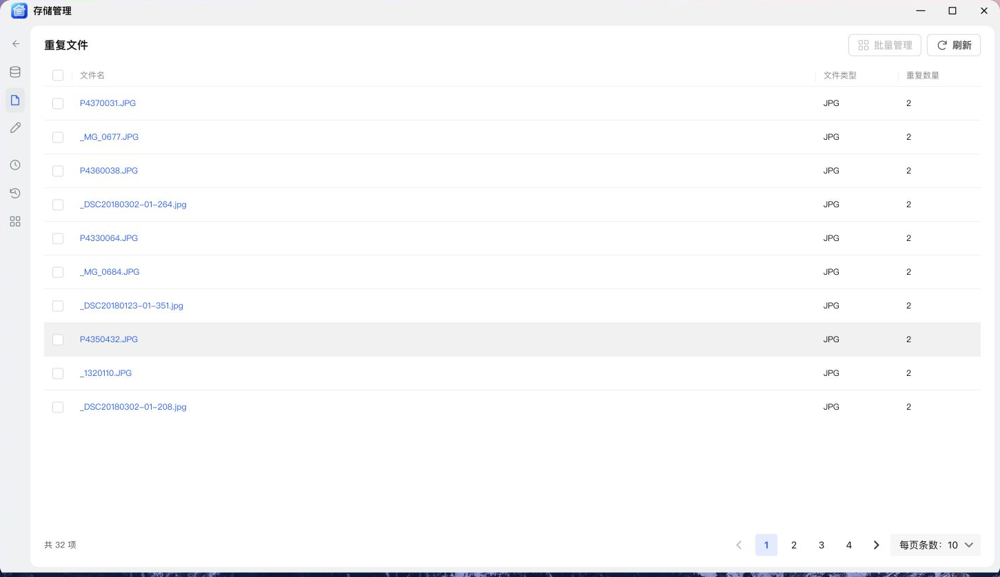
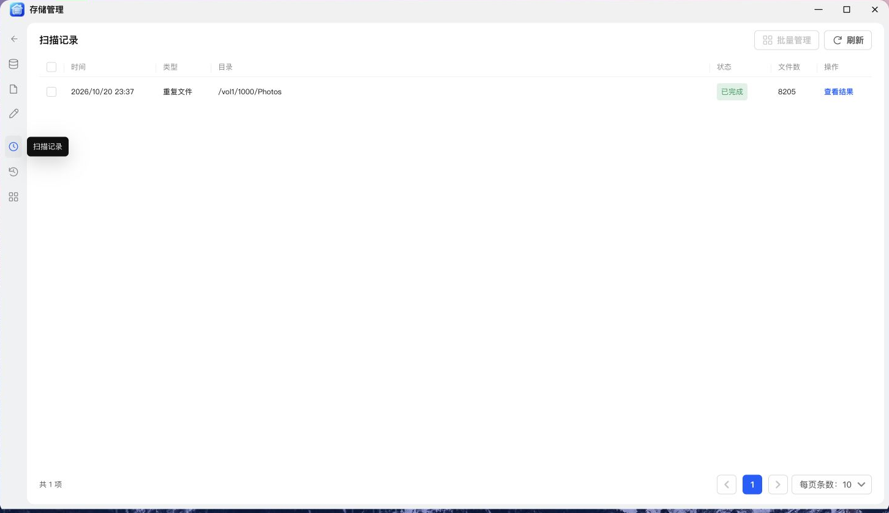
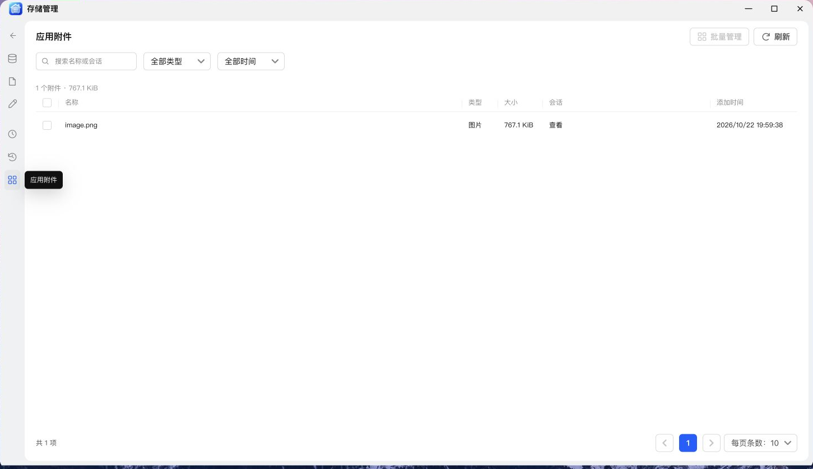

# NAS 管家——存储管理教程

> 适用版本：v0.2.52 · 配图来自 NAS 真机浏览器。表单示例仅作演示，请按自己的环境填写。

空间分析、重复检查、文件整理与处理记录，放在同一个菜单里。

---

## 先选入口，再看结果

打开 **存储管理**，先看到两个扫描卡片：

| 入口         | 解决的问题                       |
| :----------- | :------------------------------- |
| **空间分析** | 哪些目录和文件占用了更多空间？   |
| **重复检查** | 哪些文件内容相同，存在多份副本？ |

下方还有 **文件整理、扫描记录、改名记录** 等长卡片入口。已有结果时，可以继续查看上次处理结果，不需要每次都重新扫描。

进入具体功能后，左侧图标导航负责切换；PC 使用表格，手机采用更适合小屏幕的呈现方式。


## 做一次空间分析

1. 点击 **空间分析** 卡片的扫描按钮。
2. 在目录选择器中选中需要检查的存储目录。
3. 开始扫描，查看进度和结果总结。
4. 进入文件详情，查看文件名称、类型、大小、修改时间等信息。
5. 需要排序时，点击相应表头的排序图标。

第一次可以选一个相对明确的目录，例如照片或下载目录，方便核对结果。

> **说明：** 这里按文件逻辑大小统计，并对硬链接去重。  
> 它不等同于磁盘实际占用，也不包含快照独占空间；不能把统计数字直接当成“删除后必然释放的容量”。

扫描会考虑所选目录内的子目录。若达到条目、时间或内容读取等限制，结果会提示扫描不完整，不应据此断言目录中没有其他文件。

## 检查重复文件

从 **重复检查** 发起扫描后，应用先按文件大小筛选，再校验文件内容，而不是仅凭同名就判断重复。

结果表格按重复组展示，包含选择列、文件名、文件类型和重复数量。点击条目，可在详情面板查看各份副本的完整路径。

**相同名称不一定内容相同，不同名称也可能内容完全一样。** 查重结果关心的是内容。



## 批量处理重复副本

1. 在重复结果表格中勾选要处理的组。
2. 点击 **批量管理**。
3. 在处理方式中选择 **移动到指定目录** 或 **删除所选副本**。
4. 选择自动整理，或逐组手动指定保留文件。
5. 复核保留路径、待处理副本及目标目录，再确认执行。

| 整理方式         | 怎么保留                               |
| :--------------- | :------------------------------------- |
| **自动整理**     | 按路径顺序保留每组第一份，处理其余副本 |
| **手动选择保留** | 由你决定每组留下哪一个路径             |

自动保留的“第一份”不是“时间最新”或“最有价值”的意思。目录有明确用途时，建议先手动检查几组。

移动时不会覆盖同名目标。删除操作作用于实际文件，本应用不提供删除恢复；首次整理可以先选移动，检查结果后再决定后续处理。

## 文件整理：统一命名与规则改名

无需先完成扫描，也可以直接从 **文件整理** 进入目录，勾选目标文件后打开 **批量管理**。

### 统一命名

适合把一批杂乱文件整理成连续名称。例如基础名称填“旅行”，起始序号 `1`、位数 `3`，保留扩展名：

```text
原文件                    预览后的名称
IMG_8001.jpg        →     旅行_001.jpg
IMG_8002.jpg        →     旅行_002.jpg
IMG_8003.jpg        →     旅行_003.jpg
```

### 规则改名

支持查找替换、添加前缀、添加后缀、追加序号及保留扩展名。

例如，把名称中的“待整理”替换为“已归档”，或为同一项目的文件统一添加前缀。

**操作顺序：选择文件 → 设置规则 → 生成预览 → 检查冲突 → 确认改名。** 有冲突时，先调整规则，不要跳过预览。

目录中还有子目录时，可以继续进入对应文件夹处理。前进、后退用于浏览，本次所选目录是返回边界；一次改名针对当前选中的文件，不代表自动改名全部子目录中的文件。

## 扫描记录与改名记录

| 记录         | 能做什么与删除记录的含义                                           |
| :----------- | :----------------------------------------------------------------- |
| **扫描记录** | 重看扫描结果、批量删除历史记录；只删记录，不删除被扫描的实际文件   |
| **改名记录** | 查看改名前后名称，符合条件时撤销；只删记录，不会自动把文件名改回去 |

文件在改名后又被移动、覆盖或再次改名，可能不再符合撤销条件。应用会校验当前状态，不能把撤销当成任意情况下都有效的文件备份。

空间分析中的记录管理同样针对扫描记录；它与重复文件里对实际副本执行移动 / 删除，是不同的操作。



## 清理 AI 会话附件

首页下方的 **应用附件** 卡片显示附件数量与体积，点击 **查看** 进入与其他存储功能一致的详情界面。

1. 按名称或会话搜索，按类型、时间筛选。
2. 核对名称、大小、所属会话与添加时间。
3. 勾选需要移除的附件，点击顶部 **批量管理**，检查后执行清理。

桌面端分页默认显示在列表底部，每页默认 10 条；附件统计与读取状态在顶部内容区域展示。无引用文件由应用清理流程回收。



这里管理的是 AI 聊天上传的应用附件，不是 SSH 文件传输记录，也不是扫描目录中的原始文件。清理会移除实际附件文件，旧会话中的相应附件将无法再次读取；需要保留的资料请先另行保存。

## 一个顺手的整理流程

**先空间分析找重点 → 再查重复 → 把副本移动到待检查目录 → 预览批量改名 → 保留处理记录。**

不用一次整理整个存储池。先处理一个明确的目录，通常更容易确认规则是否符合自己的习惯。

---

[← 返回项目首页](../README.md) · [下一篇：网络唤醒 →](wake-on-lan.md)  
开发者 / 发布者：[kaf](https://club.fnnas.com/home.php?mod=space&uid=91804)
