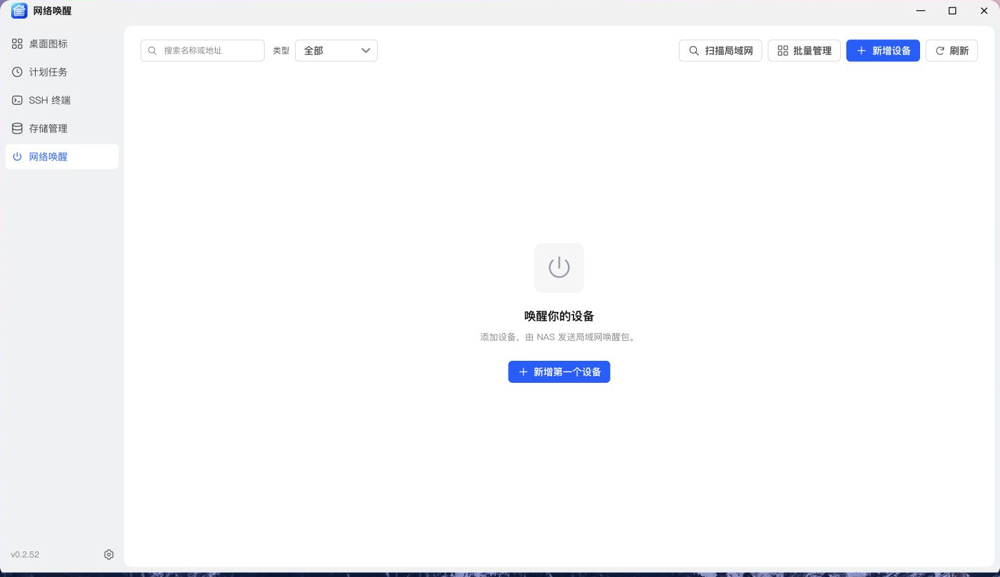
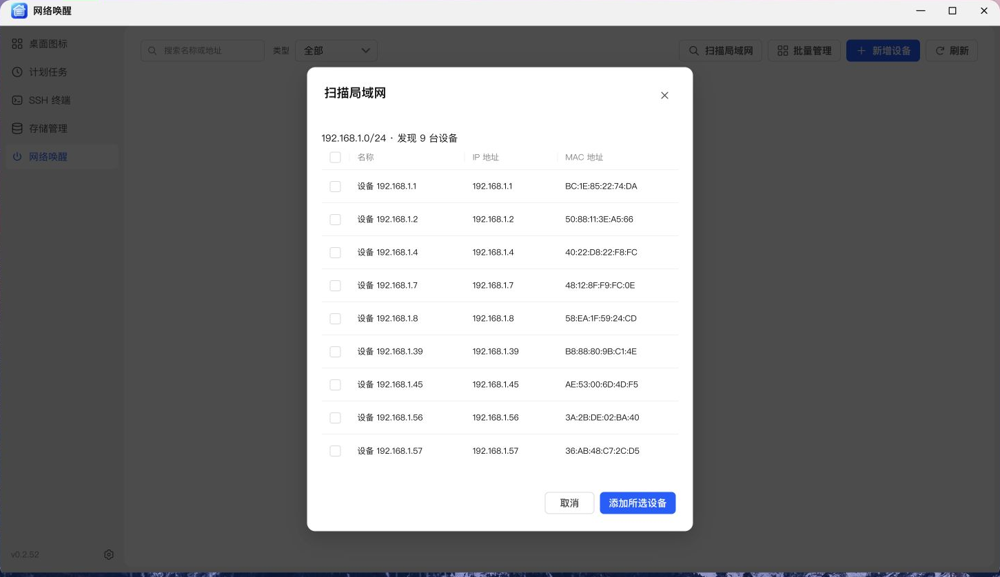
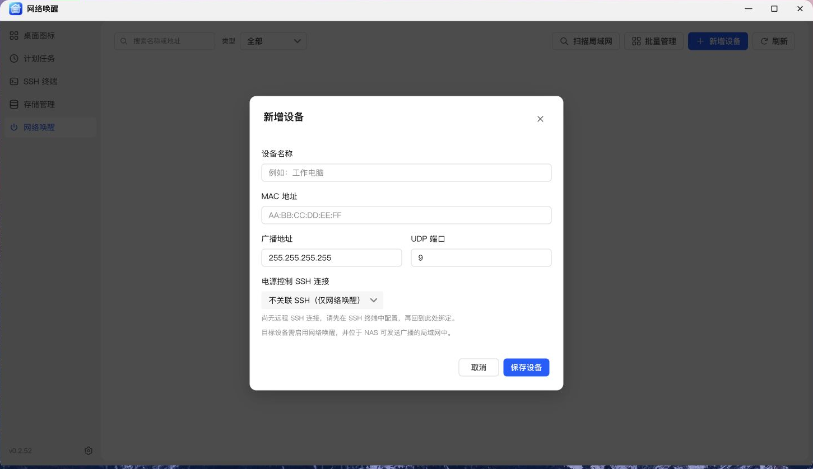

# NAS 管家——网络唤醒教程

> 适用版本：v0.2.52 · 配图来自 NAS 真机浏览器。表单示例仅作演示，请按自己的环境填写。

本篇介绍自动扫描、手动添加、批量唤醒，以及远程终端重启与关机联动。电源控制尚未完成真机验证，请先在目标设备上测试。

---

## 唤醒、关机和重启，原理不一样

| 操作            | 使用方式                        | 目标设备需要什么                     |
| :-------------- | :------------------------------ | :----------------------------------- |
| **唤醒**        | NAS 发送 Wake-on-LAN 唤醒包     | 网卡、BIOS / UEFI 及系统正确开启 WOL |
| **关机 / 重启** | 通过关联的 SSH 连接执行电源命令 | SSH 服务、有效认证及相应系统权限     |

WOL 和 SSH 的开启方法因设备而异，请查阅对应设备或操作系统的说明；SSH 可先通过本应用的终端连接测试。

不需要额外安装本应用的代理程序。但“无需代理”并不代表任何设备都能直接控制：唤醒依赖硬件与网络，关机和重启依赖 SSH 与权限。

## 使用自动扫描添加设备

1. 打开 **网络唤醒**，点击 **扫描局域网**。
2. 扫描期间会显示旋转图标和正在扫描的提示。
3. 在结果里查看名称、IP 地址与 MAC 地址。
4. 勾选需要添加的设备，点击 **添加所选设备**。
5. 添加后回到设备卡片，按自己的习惯修改名称。

扫描从 NAS 所在的局域网环境出发，并不是扫描整个互联网，也不保证发现所有网络区域的设备。

**建议在目标设备开机、联网时先扫描并保存。** 已经关机、处于其他网段或没有提供可识别邻居信息的设备，可能不会出现在结果里。

扫描到设备，只代表发现了网络信息，不代表已经确认它支持网络唤醒。

本次截图仅扫描并查看结果，没有添加设备或发送唤醒、电源控制命令。

## 手动添加设备

没有扫描到，也可以点击 **新增设备** 手动配置：

| 项目     | 示例                | 填写说明                                                  |
| :------- | :------------------ | :-------------------------------------------------------- |
| 名称     | 书房电脑            | 使用容易区分的设备名称                                    |
| MAC 地址 | `AA:BB:CC:DD:EE:01` | 填写实际用于接收唤醒包的网卡 MAC                          |
| 广播地址 | `192.168.10.255`    | 按实际网段和子网掩码填写，示例对应 `192.168.10.0/24` 网段 |
| UDP 端口 | `9`                 | 默认值，按自己的环境调整                                  |

广播地址请结合实际网络配置确认，不要直接照抄示例。唤醒失败时，可结合文末检查项排查广播是否能够到达目标设备。

保存后，点击设备卡片上的 **唤醒设备** 即可发送。

## 单台唤醒与批量唤醒

设备较少时直接点卡片；设备较多时，打开 **批量管理**：

1. 选择唤醒操作。
2. 勾选需要的设备，也可以使用全选。
3. 执行后逐台查看结果。
4. 对失败项检查配置，再决定是否重试。

> **提示：** “已发送”不等于“已开机”。  
> 它表示 NAS 已提交唤醒数据包。目标设备是否真正启动，还要结合设备状态或后续访问确认。

可通过搜索名称或地址查找设备，也可使用 **全部 / 已关联 / 仅唤醒** 筛选。

## 为设备关联 SSH，增加重启与关机

先去 **SSH 终端** 菜单保存目标设备的远程连接，并连接一次，确认地址、认证和主机指纹没有问题。

再回到 **网络唤醒 → 编辑设备**：

1. 在电源控制中选择对应的 **SSH 连接**。
2. 选择目标操作系统：Linux、Windows 或 macOS。
3. 保存后，使用设备卡片的电源操作，或在批量管理中选择重启 / 关机。

本菜单只关联已有 SSH 配置，不需要在这里重复新建一套连接。

### 为什么登录成功，电源控制仍失败？

SSH 登录权限与关机权限并不相同。

Linux / macOS 的非 root 用户需要能够无交互执行相应电源命令；Linux 目标还需支持使用的系统电源命令。Windows 则需要启用 OpenSSH 服务，并具备对应关机 / 重启权限。

因此，先确认 SSH 能登录，再检查操作系统类型和电源权限，通常比反复修改 MAC 地址更有效。

## 联动计划任务

设备配置完成后，进入 **计划任务**，选择网络设备相关任务，勾选目标设备并设定时间。

例如：

- 工作日早上唤醒书房电脑；
- 固定维护时间重启测试主机；
- 在确认没有任务运行的时段关闭闲置设备。

唤醒不要求设备的 SSH 在线；关机和重启则要求设备在线、SSH 可达，并且关联配置有效。

## 唤醒没有反应，按这个顺序检查

| 顺序 | 检查内容                                     |
| :--- | :------------------------------------------- |
| 1    | 目标硬件及 BIOS / UEFI 是否支持并启用 WOL    |
| 2    | 操作系统、网卡驱动是否允许相应状态下被唤醒   |
| 3    | MAC 是否属于当前联网、支持唤醒的那张网卡     |
| 4    | NAS 与目标设备是否处于允许广播到达的网络     |
| 5    | 广播地址、UDP 端口、交换机及路由规则是否正确 |

跨网段、访客 Wi-Fi、AP 隔离等网络条件会影响结果。优先在同一局域网、有线连接的条件下完成首次验证。

---

[← 返回项目首页](../README.md) · [回看：计划任务联动](scheduled-tasks.md)  
开发者 / 发布者：[kaf](https://club.fnnas.com/home.php?mod=space&uid=91804)
